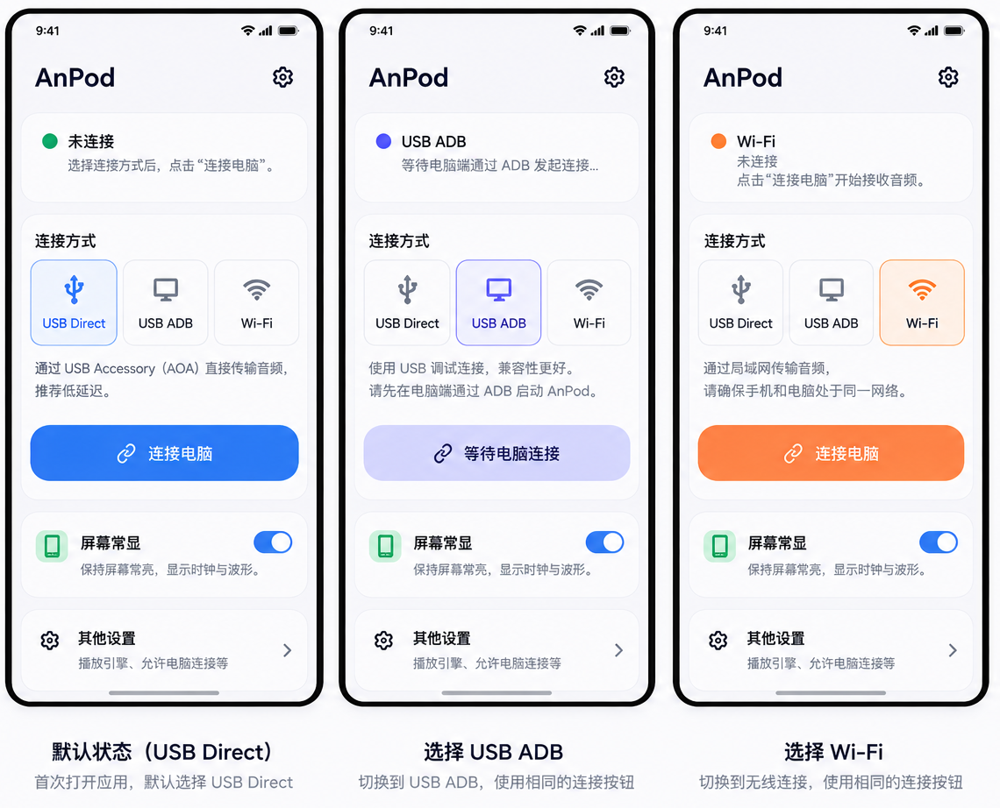
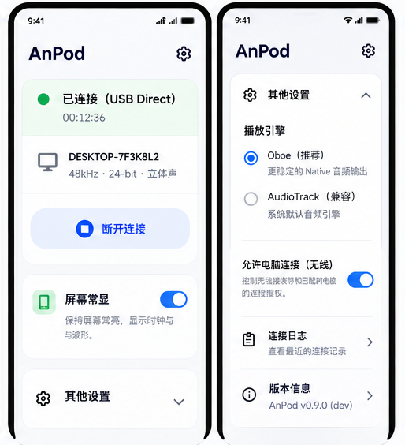
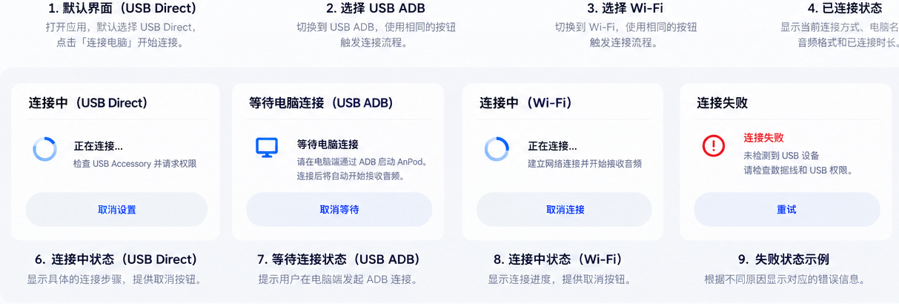

# AnPod Android 手机端 MD3 UI/UX 重构实施规划

> 状态：**设计与交互方案已确认，已附效果图；等待明确的代码施工指令**  
> 编写日期：2026-10-22  
> 代码基线：[`sanren1/AnPod` / `dev`](https://github.com/sanren1/AnPod/tree/dev)，`ffea50f824e1ae464dc937d191660783870a3ddb`（2026-10-22 09:40:46 UTC）  
> 设计依据：用户确认的三模式单选、统一「连接电脑」按钮、AOD 首页保留并改名「屏幕常显」、其他设置原位展开、原生 Material 3 简约风格，以及 **USB ADB 由电脑端发起，手机端仅显示等待/指引** 的边界。

## 0. 产品目标、明确不做的事

### 目标

1. 手机首页同时展示 **USB Direct / USB ADB / Wi-Fi** 三种互斥连接方式；首次默认 USB Direct，此后保留手机端本地手动选择。
2. 三种模式都通过同一主要操作入口「连接电脑」触发相应流程；状态文案准确，不制造虚假的已连接或正在接收状态。
3. 首页次序固定：**应用名 → 连接状态 → 连接方式与主按钮 → 屏幕常显 → 其他设置**。
4. 将现有 `OutputEnginePicker`、无线后台「允许电脑连接」及其完整授权管理移到单个连续的「其他设置」原位展开区域。
5. 采用纯 Compose Material 3 色彩、排版、圆角、动画与可访问性语义；支持动态配色、深浅色、大字号、窄屏。
6. 保留现有 AOA / USB ADB / Wi-Fi UDP 的安全配对、权限、状态机、播放及恢复功能。

### 非目标（严格禁止顺手扩大范围）

- 不重写 `ReceiverService`、`AoaReceiverCoordinator`、UDP/ADB/AOA 协议、密钥/绑定、AudioTrack/Oboe、音频质量与延迟算法。
- 不给 Android 端增加开启 ADB、授权 USB 调试或主动在 Windows 上执行 ADB 的能力。
- 不在手机选择模式时自动操作 PC 端连接设置、触发 AOA 模式切换或修改 USB 驱动。
- 不将「允许电脑连接」简化为永久放行开关；保留授权时效、电脑绑定指纹、用户确认和撤销功能。
- 不改变现有默认 **Oboe**（此项以当前 `dev` 分支为准）、AOD 行为、Android 最低 API、主题配色来源。
- 不为 UI 改造额外引入第三方 UI 组件库。

## 1. 源码审查结论（已验证）

| 现状/问题 | 代码定位 | 处置 |
|---|---|---|
| 当前主按钮的 `connectComputer()` = `beginReceive(false)`，实际是网络接收，不是泛用 USB 按钮 | `MainActivity.kt` ~313、~456、~698–711 | 建立 UI 层 `onPrimaryConnect(mode)` 显式分派；业务调用仍复用原函数 |
| USB Direct 独立按钮在 `showMoreMethods` 展开区 | `MainActivity.kt` ~716–744 | 去除次级独立按钮，将 AOA 检查/授权入口接至统一主按钮 |
| 一个 `showMoreMethods` 在 AOD 上下控制两块非连续内容 | `MainActivity.kt` ~716–827 | 仅保留一个连续 `OtherSettingsSection`，紧跟在 AOD 卡片下方 |
| USB Direct 的附件识别、权限申请、过期请求、取消/恢复均已有实现 | `MainActivity.kt` ~315–454，`AoaReceiverCoordinator.java`，`ReceiverService.java` | 原样复用权限/生命周期方法；不通过 UI 绕开校验 |
| Wi-Fi 使用 `interfaces`、地址/前缀、`pendingConnection` 与 `startReceiving` | `MainActivity.kt` ~132–173、~456–534 | 复用既有网络接收函数；只调整入口及网络选择的呈现位置 |
| ADB 真实会话从 PC 经 `BootstrapActivity` 进入 Receiver | `BootstrapActivity.java`、`ReceiverService.java` | 手机 ADB 模式仅引导等待，真实连接由系统快照判定 |
| 会话种类/状态及发动机实际回退信息已在 `UiSnapshot` | `ReceiverUiState.java`、`UiSnapshot.java` | 优先复用，谨慎修复含糊的 `usb-or-local` 显示，不凭用户选择推断真实连接 |
| 当前 Android 默认 `outputEngine` = `oboeExperimental`，落盘键 `output_engine` | `MainActivity.kt` ~104、~260–266、~299–303 | 原默认/偏好不变；只搬迁 UI |
| `ReceiverTheme` 已支持 Android 12+ 动态色及深浅色 | `MainActivity.kt` ~574–585 | 保持现有主题，去掉连接方式依赖的硬编码蓝/绿/橙色 |
| 项目已有 Compose BOM `2025.06.00` 与 `androidx.compose.material3` | `src/AnPod.Receiver/app/build.gradle` | 使用官方 MD3 控件，不新增依赖 |
| Android `minSdk=23`；AOA 需要 API 24+ | Android Gradle/当前 AOA 代码 | USB Direct 不满足 API/硬件能力时显示具体原因；ADB/Wi-Fi 不因此被阻断 |

## 2. 最终信息架构

静止时从上向下固定顺序：

```text
AnPod                                   （顶栏，保留现有导航策略）
┌──────────────────────────────────────┐
│ 未连接 / 等待电脑 / 已连接 / 正在接收... │ ① 状态（短标题+一句原因/下一步）
│ 错误详情（仅必要时展开）                 │
└──────────────────────────────────────┘
┌──────────────────────────────────────┐
│ 连接方式                              │ ② 核心操作
│ [ USB Direct ] [ USB ADB ] [ Wi-Fi ] │    单选 MD3 Segmented
│ 当前模式一句简短说明                   │
│         [ 连接电脑 ]                 │    唯一主按钮
│ 连接期间的取消/等待/失败提示显示在本区   │
└──────────────────────────────────────┘
┌──────────────────────────────────────┐
│ 屏幕常显                      [开关]  │ ③ 始终显示
│ 显示时钟、波形及播放状态      预览常显  │
└──────────────────────────────────────┘
┌──────────────────────────────────────┐
│ 其他设置                         [⌄] │ ④ 默认折叠
│ ├─ 播放引擎：Oboe / AudioTrack         │
│ └─ 允许电脑连接（无线）               │
│      状态/启动等待/停止等待/记住或撤销授权 │
└──────────────────────────────────────┘
```

### 2.1 MD3 效果图（已确认的方向，作为施工视觉参考）

> **图片使用说明**：以下图片为交互讨论阶段形成的概念效果图，不是 Android 实机截图、不是已实现 UI，也不是要求逐像素复刻的设计稿。**本文的状态机、UI 层级及 MD3 规范高于图片中未确认的视觉细节**。图片保存在本文件旁的 `assets/` 目录中，请连同 Markdown 一起交付，不能仅复制 Markdown 文件后留下失效的图片路径。

#### A. 首页：USB Direct（默认）、USB ADB、Wi-Fi 三种选择



- 采用相同的首页布局：状态区域、三选一连接方式、单一「连接电脑」按钮、始终可见的「屏幕常显」、末尾「其他设置」。
- 图片中不同模式使用了蓝/紫/橙色强调；**正式实现不按模式换色**，统一使用当前 Material 3 动态主题 `colorScheme.primary` / `primaryContainer`。
- USB ADB 的「等待电脑」不是成功建立 ADB 连接；必须由 PC 端真正启动并在服务快照出现对应状态后才显示已连接。

#### B. 实际已连接 + 「其他设置」原位展开



- 已连接时应根据**实际服务快照**显示协议、等待播放/正在接收、会话状态；图片中的设备名、音质、连接时长均为虚构占位值，仅用于表达排版。
- 设置区应在首页的「屏幕常显」下方**原位展开**，不能做成独立 Bottom Sheet / 新页面；展开后播放引擎和「允许电脑连接（无线）」必须处于同一连续容器内。
- 展开内容**仅承接已存在的功能**：Oboe / AudioTrack、实际引擎与回退原因、完整无线后台授权与撤销。效果图里出现的额外「连接日志」「版本信息」仅作排版示意，**不代表本轮新增功能**。

#### C. 连接中、等待电脑与连接失败等状态



- **USB Direct**：检查附件、USB 权限、启动会话，允许取消，失败原因就近展示。
- **USB ADB**：只显示请电脑端发起的等待与帮助，不在手机发起伪连接，也不调用 Wi-Fi 接收启动函数。
- **Wi-Fi**：启动现有监听/接收路径，正确区分「等待电脑」和「已收到音频」，取消、断开按现有 owner/generation 处理。
- 概念图中的按钮文案、进度环和颜色仅用于解释状态。**验收以第 3 节的真实状态优先级与按钮表为准**。
- 如需要选择网络，应展示当前 App 获取到的**网络接口 / IPv4 地址 / 前缀**；概念图中的 Wi-Fi 热点/SSID 列表不能照搬成真实功能，更不能替应用切换 Android 系统网络。

#### D. 原始完整设计画板（便于横向对照）

- [完整首页设计画板](assets/04-full-home-design-board.png)：包含三个首页模式与早期设置表现；其中「底部弹层」**已被否决，不得实现**。
- [完整状态设计画板](assets/05-full-state-design-board.png)：包含连接成功、设置展开、等待、失败及网络选择等概念状态；仅作为视觉参考。

**图片优先级及实现原则**：`第 2 节页面顺序 / 第 3 节状态行为 / 第 4–5 节功能归属 / 第 8 节验收标准` ＞ 效果图；若图片与文字不一致，按**用户已经确认的本文文字**开发，并在实现报告中列出差异，不擅自增加功能。

**展开层级不穿插：**「其他设置」只有一个 Compose 父容器，它的所有展开子项排在 AOD 之后。错误详情仍隶属于状态区域；网络恢复/选择属于连接卡片流程，不在 AOD 下方追加游离卡片。

### 视觉规范

- 主题采用现有 `MaterialTheme.colorScheme`，Android 12+ 的 Dynamic Color 保持。三种传输模式**不换强调色**；主要选中态均使用主题 `primary/primaryContainer`。
- 尽可能使用 `Surface`、`Card`（`surfaceContainer`、`surfaceContainerLow`）和 `Button`；不使用荧光渐变、玻璃质感、大片投影或纯装饰图标。
- 页面四周留白建议 16–20dp，卡片纵向间距 12dp，内容 padding 16dp；尺寸随窗口/字体调整，不通过极小字号强行塞入三段选项。
- 主操作目标最低 48dp，建议高度 52–56dp；Switch、单选区域提供辅助功能标签。
- `SingleChoiceSegmentedButtonRow` + `SegmentedButton`；只有窄屏/大字号确实放不下时，优雅退化为纵向三行单选选项，避免横向裁切。
- 动画仅限轻量 `AnimatedVisibility`/颜色过渡；遵守系统「移除动画」/降低运动偏好，不以动画判定状态。
- 支持浅/深色、320/360/393/412dp 以及至少 1.0/1.3/1.5 字体倍率，中文/英语文案不截断关键动作。

## 3. 模式偏好模型与行为

建议新增 Android 本地 UI 偏好：

```kotlin
enum class ConnectionChoice { USB_DIRECT, USB_ADB, WIFI }
// SharedPreferences("anpod_receiver") 的键："connection_choice"
// 默认 USB_DIRECT；仅 UI 手动选择后持久化
```

必须区分三个维度：

1. **选中模式（requestedChoice）**：用户希望下一次使用的方式；持久化于手机本地，不代表 PC 设置已同步。
2. **实际会话方式（actualTransport）**：只有从服务认证快照读到，才可以显示为「已连接 USB Direct / USB ADB / Wi-Fi」。
3. **UI 引导阶段（localIntent）**：例如 ADB 的 `WAITING_FOR_PC`，仅表示用户正在阅读/等待电脑动作；不得写入 `UiSnapshot.operationState`、启动后台服务或计为真正连接。

首次启动无偏好时默认为 Direct；用户之前选择的有效选项保留。PC 端 `wiredMode` 是另一套独立偏好：不默默同步，也不修改 PC 设定。发现 PC 模式不匹配时提供清晰建议，不自动换协议。

### 统一主按钮动作（业务分派）

| 本地选中 | 空闲时点击「连接电脑」 | 可取消什么 | 何时算真正「已连接」 |
|---|---|---|---|
| USB Direct | 复用 `connectUsbDirect()`：校验 API24+/Accessory/配对、系统授权、启动 AOA | 在权限挂起时复用 `cancelUsbPermission()`；启动/运行中使用现有 owner-aware stop | `UiSnapshot` 表示真实的 AOA 认证/会话开始，具体文案区分等待音频与播放中 |
| USB ADB | 显示就地引导「请在电脑端使用 USB ADB 连接这台手机」，可提示检查 USB 调试/PC 当前模式；**不调用** `beginReceive` | 「关闭引导」只清理本地 UI 等待态，不发送虚构的停止指令 | PC 经 ADB 真实启动 Receiver，认证/启动结果体现在真实 `UiSnapshot` |
| Wi-Fi | 复用 `beginReceive(false)`；先判断可用网络接口：0 个提示修复，1 个可直用，多个需要明确有效选择 | 使用已有 `pendingConnection`/generation 取消，真正已经运行时走 owner-aware stop | Wi-Fi 接收就绪显示「等待电脑」，实际连接和音频推进由真实服务状态决定 |

注意：Wi-Fi 的「多个网络」指 **多个可用的网络接口/IPv4 地址**，不是重新设计一个可以修改系统 Wi-Fi SSID 的选择器；当前已有 `InterfacePicker` 需要保留原信息及校验。

### 主按钮和状态文本的通用状态机

| 底层/界面条件 | 标题 | 主操作 | 禁用/特殊规则 |
|---|---|---|---|
| 未绑定/尚未准备 | 未连接 | 连接电脑 | 可点击查看配对引导，不默默创建绑定 |
| Direct 访问权限等待 | 等待 USB 权限 | 取消连接 | 使用系统授权对话框；拒绝后可重试 |
| Direct/Wi-Fi 实际启动中 | 正在连接 | 取消连接 | 仅当前有效 operation generation 可取消；防重复点击 |
| ADB 点击按钮后的本地引导 | 等待电脑操作 | 查看连接指引 / 关闭引导 | 不能把这个状态写为 `prepared`、`authenticated` 或 `streaming` |
| Wi-Fi Listener ready 但 PC 未连接 | 等待电脑连接 | 停止等待 | 保留服务 owner/state 和通知逻辑 |
| 已认证但尚无音频推进 | 已连接 · 等待播放 | 断开连接 | 不显示「正在接收」 |
| 收到音频且正在推进 | 正在接收 | 断开连接 | 显示真实会话模式（可选输出格式） |
| 暂停 | 已暂停 | 断开连接 | 不是故障 |
| 异常 | 连接失败 | 重试/连接电脑 | 展示可执行的简短原因；日志放在「详情」 |
| 停止中 | 正在断开 | 正在断开… | 禁止重复 stop、模式切换与新连接 |

**状态优先级**：真实已认证/播放会话 > 真实服务连接/停止/错误 > 仅本地 ADB 等待引导；用户选择模式仅影响下一次主动动作。若 PC 主动通过 ADB 建立了会话，即使本地仍选 Direct，也要正确显示「实际：USB ADB」，并锁定协议选择直到会话结束。

### 当前会话期间模式切换

在任何 `starting/running/stopping` / `prepared/authenticated/receiverRunning/streaming/paused` 状态禁用选择控件，避免多条链路竞争。一旦操作完全结束解锁。**不因点击另一分段按钮直接断开当前会话**。不允许 UI 隐式停止/开启其他服务。

## 4. 「屏幕常显」卡片

- 原 AOD 卡片原位保留于首页第三段，主标题改为 **「屏幕常显」**（原文案为「常显屏幕」）。
- 保留开关、当前启用偏好 `aod_enabled` 和「预览常显」入口。
- AOD Activity、触发策略、波形、音量/通知/前台服务保持原样；不能因展开设置改变自动进入 AOD 的时机。
- 提示文字一行或最多两行：「接收音频时显示时钟与波形，屏幕会保持点亮」。

## 5. 「其他设置」卡片

默认折叠，点击标题/chevron 在**同一卡片内部**展开：

1. **播放引擎**：保留现有 `OutputEnginePicker` 的 Oboe（默认）与 AudioTrack（备用）选择、实际引擎、XRun 及回退原因；设置在**下次会话生效**，不得中途热切换。
2. **允许电脑连接（无线）**：复用原 `backgroundStandbyStatus()`/`backgroundGrantStatus()`，展示真实等待服务状态；保留 `startBackgroundStandby`、`stopBackgroundStandby`、`trustBindingUntilRevoked`、`revokeBackgroundTrust`、确认对话框、通知权限引导、到期与错误恢复。**不能将其改成不带授权语义的普通 Switch**。

不建议另开 Settings Activity/BottomSheet；不在 AOD 前插入次级区域；不额外加入功能不明确的日志页。诊断文本继续就近显示在连接状态错误详情内。

## 6. 详细异常与兼容处理

- **未配对**：三模式都提示首次 USB 绑定/配对入口，禁止创建未经授权的 PC 绑定；不绕过 AOA 已有配对要求。
- **Direct 未插线/Accessory 未枚举**：允许用户点击以得到清晰的提示；不发生自动 ADB/Wi-Fi 回退。
- **Direct API23/无 `FEATURE_USB_ACCESSORY`**：置灰 Direct 模式或显示原因，同时允许选择 ADB / Wi-Fi。原有兼容门槛不变。
- **Direct USB 权限拒绝/超时/拔插**：沿用 pending generation、附件 identity、失效检查，取消订阅/接收器注册必须成对，重复回调不能触发二次 start。
- **USB ADB 手机端**：仅等待操作指南；PC 发起后依据服务快照进入正确真实状态；切换到其他模式/退出页面时仅清理本地指引，不取消非自己创建的 PC 会话。
- **Wi-Fi 无可用接口**：给出「请先连接可互通的 Wi-Fi/网络」；仅一个接口直接预选，多个接口选有效 `address/prefix`；已保存接口过期时不得复用失效地址。
- **Wi-Fi 后台授权**：授权缓存与监听按现有 owner 管理；主动连接与后台等待有不同生命周期，UI 不应二者合并为永久授权。
- **停止/重连竞争**：复用 `discoveryGeneration`、`operationId`、`operationGeneration` 校验，晚到的成功/失败不会覆盖新状态或自动重启旧会话。
- **进程被系统回收、旋转、深浅色变化**：本地模式偏好从持久化加载；服务状态从快照恢复；不恢复任何仅 UI 的伪会话。
- **旧 PC / 新手机，旧手机 / 新 PC**：不修改底层协议及绑定储存格式；新 UI 不用协议不支持的能力冒险强制连接。

## 7. Compose 施工分解（按风险从低到高）

### P0 — 保护当前状态与基准

- 以 `ffea50f` 建可回退 UI 分支；检查 `dev` 后续是否更新，若更新先审 diff，禁止未经核对覆盖新的 AOA/授权逻辑。
- 冻结当前 `MainActivity`/`ReceiverService` 的关键连接状态回归案例，留存首页、AOD、展开区域截图。
- 建立「用户选择 vs 真实传输」的状态测试向量，特别覆盖 ADB 由 PC 发起与 AOA 权限过期。

### P1 — 模式偏好与纯逻辑分派（不改底层）

- 新建轻量 `ConnectionChoice` enum、持久化和纯函数 `primaryActionFor(choice, realState)`；将 Direct/ADB/Wi-Fi 行为映射测试先行。
- 保留 `connectUsbDirect()`、`beginReceive()` 与现有 `onStop`，只在 `MainActivity` 入口做薄分派；ADB 的主动动作仅显示指引。
- 会话启动后真实 `UiSnapshot` 覆盖本地引导；确保模式保存不修改 PC `wiredMode`。

### P2 — 首页结构与 MD3 控件

- 将 `ReceiverScreen` 拆成有限的私有 Composable（建议）：`ConnectionStatusCard`、`ConnectionMethodCard`、`AodSettingsCard`、`OtherSettingsCard`。
- `ConnectionMethodCard` 使用 `SingleChoiceSegmentedButtonRow`、唯一主按钮和短说明；需要窄屏降级时使用三项单选行。
- 移除 `showMoreMethods` 的双重渲染分支，合并为单个 `otherSettingsExpanded` 状态 + `AnimatedVisibility`。
- 标题改为「屏幕常显」，保留原 Toggle/Preview 调用。
- 分离状态可视化和业务回调；Compose Recomposition 不得发起连接，业务只由明确点击处理。

### P3 — 错误、动画和访问性

- 支持真实状态文案和错误详情；仅对错误/状态标题使用适度 live region，避免屏幕阅读器反复播报刷新。
- 确认所有操作 target >=48dp；Segmented 对辅助功能可报单选/选中状态；加载状态下重复操作被锁定。
- 验证中英文、横竖屏、多窗口、动态配色与暗色、字体放大。
- 用字符串资源实现全部新文案，不在 UI 硬编码中文提示。

### P4 — 自动回归与真机验收

- 本地 Android Gradle：`gradlew.bat :app:assembleDebug :app:testDebugUnitTest`（在 `src/AnPod.Receiver` 内，按现有脚本实际配置适配）。
- 建议添加状态机单元测试与 Compose UI instrumentation tests（已具备 `androidTest` 目录），验证布局顺序、展开/收起、主按钮与后台授权的交互。
- 真机设备：iQOO 11 / Android 16 为核心，另测 API23 或模拟器缺失 Accessory 能力、Android 12+ 动态色。未运行的实机场景必须标 `NOT_TESTED`，不能以编译通过替代。

## 8. 验收检查表（完成施工后的 Done 标准）

- [ ] 与 `assets/01`–`03` 的视觉布局及状态层级一致；图片中被本文否决的 Bottom Sheet、随连接方式变换主题色和 Wi-Fi SSID 选择器均未实现。

- [ ] 无历史偏好时选择 USB Direct；手动选择 ADB/Wi-Fi 关闭应用后仍保留，PC 偏好不变。
- [ ] 首页静止顺序严格为：状态 → 连接方式/主按钮 → 屏幕常显 → 其他设置。
- [ ] 在 Direct 下不用展开任何次级卡片即可点击连接、请求权限、取消权限、收到配对/附件错误提示。
- [ ] 在 ADB 下点击主按钮只显示「请电脑端发起」；不启动 Wi-Fi 服务，也不伪造连接状态；PC ADB 真正连上后显示真实状态。
- [ ] Wi-Fi 唯一有效接口时直接开始接收；多个接口可选择，过期/无接口有明确提示；取消和超时行为不倒退。
- [ ] 会话活动、停止中锁定三模式切换；切换偏好不会导致 USB 重枚举/ADB 服务变化。
- [ ] AOD「屏幕常显」开关、预览、自动进入逻辑与旧版一致，页面展开不会导致 AOD 位置被穿插。
- [ ] 「其他设置」原位展开，Oboe/AudioTrack 选择与运行时真实引擎/回退诊断保留。
- [ ] 「允许电脑连接（无线）」完整保留停止等待、临时/长期授权确认、撤销、错误、权限与绑定约束。
- [ ] 暗色、动态色、窄屏、大字号、TalkBack 不溢出、不遮挡，单选、开关、加载与错误均有正确无障碍语义。
- [ ] `assembleDebug`、现有 JVM 单测、相关新增测试通过；真实 USB Direct、ADB、Wi-Fi 与 AOD 验收分别有可追溯证据。
- [ ] 无任何变更涉及音频协议/加密/密钥/采集、Native 播放或 PC USB 驱动。

## 9. 可复用项目与官方指南

| 文档 / 源码 | 用途 | 处理 |
|---|---|---|
| [Android Compose Material 3](https://developer.android.com/develop/ui/compose/designsystems/material3) | 现有 `ReceiverTheme` 的动态颜色、ColorScheme、MD3 风格 | 已有依赖，继续使用 |
| [MD3 Segmented Button](https://developer.android.com/develop/ui/compose/components/segmented-button) | `SingleChoiceSegmentedButtonRow`，三选一与选中态 | 直接调用 Compose 内建 API |
| [Compose AnimatedVisibility](https://developer.android.com/develop/ui/compose/animation/composables-modifiers) | 原位展开其他设置、轻量动画 | 直接调用 Compose 内建 API |
| [Android USB Accessory](https://developer.android.com/develop/connectivity/usb/accessory) | Direct 系统权限/附件状态边界 | 复用现有 `UsbManager`，不新增授权机制 |
| [`sanren1/AnPod` 当前 dev](https://github.com/sanren1/AnPod/tree/dev/src/AnPod.Receiver/app/src/main/java/app/anpod/receiver) | 状态/权限/AOD/网络生命周期基线 | 先复用，再做局部 UI 重构 |

## 10. 交给 AI 开发 Agent 的执行提示

> 依据本文及随附 `assets/` 视觉效果图在最新 `dev` 的独立 UI 分支实施 Android Receiver 首页重构。首先重新读取 HEAD 并比较本文基线 `ffea50f`；若有冲突先报告。严格保持 USB Direct/ADB/Wi-Fi、配对授权、AOD、后台等待授权、音频输出与安全状态机的既有行为。先补纯状态/动作单测，再做 `MainActivity.kt` Compose UI 拆分；三种连接方式共用唯一主按钮，ADB 仅引导电脑发起；其他设置必须连续原位展开在「屏幕常显」之后。不得引入第三方 UI 库、硬编码主题颜色或隐式协议切换。实现后输出变更清单、测试 PASS/FAIL/NOT_TESTED、需真机验证项目及一键回退说明。

---

**实施状态（2026-10-22 更新）**：已在 `codex/ui-refresh` 实施，手机源码提交 `26f538a`、修订 `7f3e632`；Receiver `0.18.0-v3-flow-candidate/code41`。三模式持久偏好、单主操作、真实状态优先、屏幕常显及连续内联其他设置已落地。独立预审发现的 ADB 标签、多接口恢复入口、旧本地错误及权限等待误报已修复，ADB 重复文案已收短。

**离线验证**：当前完整 JVM 13 suites / 94 tests、0 failures/errors/skipped；`lintDebug` 执行成功，原始 XML 为0 Error、59 Warning、4 Information，`assembleDebug` 通过。原始记录在 `artifacts/ui-refresh-20261022/android-ci/`，lint XML 在 `src/AnPod.Receiver/app/build/reports/lint-results-debug.xml`；未比较同条件基线，不判定警告新旧比例。release APK 已沿用原发布证书构建，`sourceModified=false`，元数据在 `artifacts/ui-refresh-20261022-receiver41/receiver.json`。这不是实机验收记录。

**实机边界**：按用户要求不重启旧实机核查；本轮未安装或操作手机。实际三链路、配件权限/热插拔、AOD、动态色/字体/横屏及 TalkBack 仍为 **NOT_TESTED**。因此以上涉及实机的验收勾选不凭编译或 JVM 结果勾为通过。最终独立复审与交付汇总见主规划第15节。
