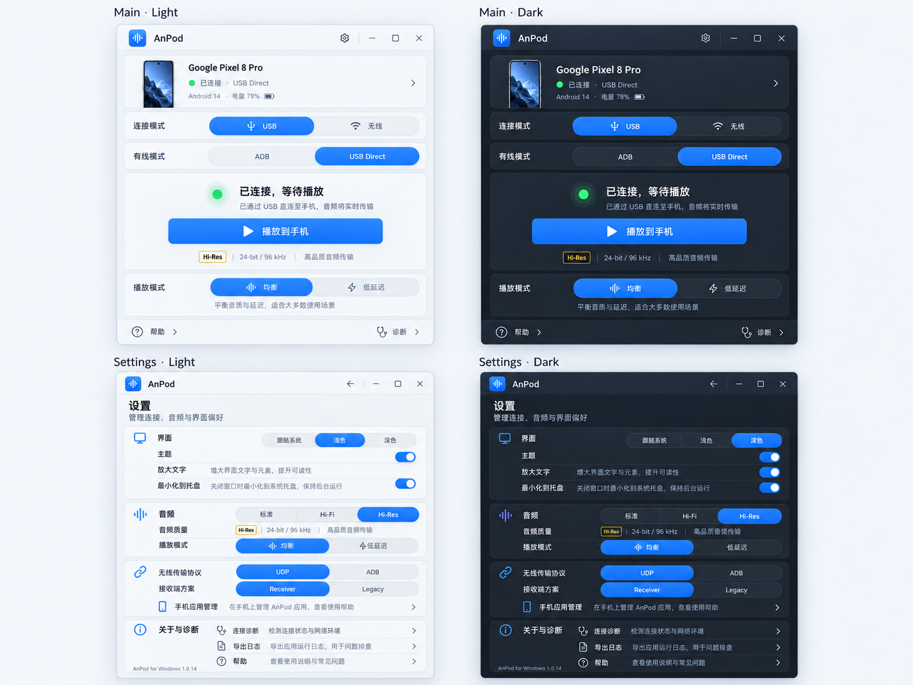
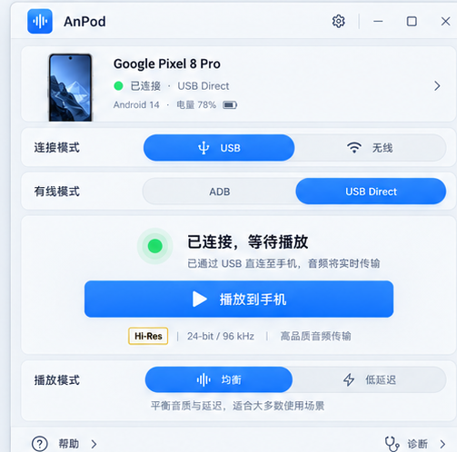
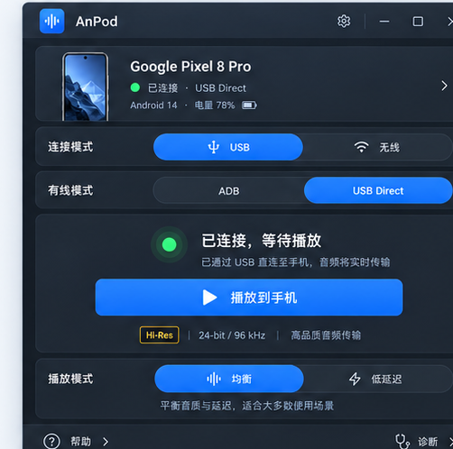
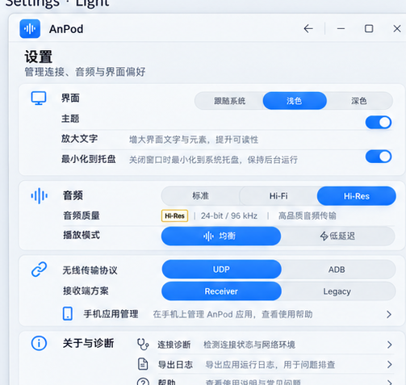

# AnPod PC UI/UX 重构规划 · Soft Minimal（方案 A 已选定）

> **用途**：包含已选定设计效果图的 AI 开发执行规划；仅重构 Windows PC 端 UI/UX。  
> **基线核查日期**：2026-10-22  
> **仓库**：https://github.com/sanren1/AnPod/tree/dev  
> **固定基线**：`dev@ffea50f824e1ae464dc937d191660783870a3ddb`（读取时的分支 HEAD；执行前应重新确认 SHA）  
> **当前 PC 版本**：`1.10.14`；Android Receiver `0.17.6-v3-flow-candidate / code 40`，尚未宣称实机验证。  
> **视觉方案结论**：用户已从 A/B/C 三套视觉风格中选择 **A：柔和极简 Soft Minimal**，不再将风格选型作为待办。设计参考以 [Twinkle Tray](https://github.com/xanderfrangos/twinkle-tray) 为主，辅以 [EarTrumpet](https://github.com/File-New-Project/EarTrumpet) 的直观性和 [Files](https://github.com/files-community/Files) 的设置分组。  
> **本规划与原规划关系**：`AnPod_UI_UX_Plan/plan.md` 已实施的流程精简是既有成果，本文件规划**后续 PC 视觉与交互呈现重构**，不重复、推翻既有决定。  
> **修改边界**：不经单独审议，不修改协议、音频引擎、设备绑定、Receiver Android UI、签名发布及恢复策略。

---

## 0. 首要结论

**保留 Tauri 2 + React 19 + TypeScript + Vite + Rust；增量引入 Motion 用于少量共享布局/弹性动画；以现有 CSS variables 为起点建立设计 Token 和组件样式，不建议全量引入 Tailwind/shadcn 后推倒重写。**

界面目标为 **AnPod Soft Minimal**：小而清楚的“连接优先”音频控制面板。视觉上采用中性石墨灰/浅银灰、低饱和蓝灰强调色、轻量分组和少量动画；UX 上让用户在几秒内看清“连接哪个手机、用什么路径、当前是否真正传音、下一步该做什么”。**保留上一版的主屏/设置页基本布局，不将 UI 改造成复杂仪表盘。**

### 明确不做

1. 不把 420×590 的紧凑应用改造成必须依靠侧边栏的大型仪表盘。
2. 不为视觉效果修改 `src-tauri/src/state/`、USB/UDP/AOA、安全/认证或音频采集逻辑。
3. 不为了统一命名重新定义后端 `Snapshot.state`、增添第二套连接状态机。
4. 不伪造波形、电平、96 kHz/24-bit、延迟或音频播放成功状态；不存在可靠 telemetry 时展示“未确认”。
5. 不默认启用自定义无边框窗口、透明 Acrylic 或高开销全窗口实时模糊。
6. 不强制引入 Redux、全量 React Router、Tailwind、shadcn/ui、GSAP、Lottie 等非必要依赖。
7. 不改变用户已确认的名称 **USB Direct、兼容方式**，保持音质三档 **标准 / 高保真 / Hi-Res**；不要加入隐式降档、自动 SRC。
8. 不修改手动断开后不自动重连的规则；意外断连沿用既有有限恢复语义。

---

## 1. 已选定效果图与设计落地要求

> **重要：本节的四张效果图是风格与布局意向稿，不是 GitHub 当前运行界面，也不是功能验证截图。** 图片由设计工具生成，可能包含尚未获得的数据、演示设备名、夸大的音质以及与真实交互不一致的控制项。真实实现应遵守下面的“效果图与功能映射”规范，而非逐字逐图照搬。

### 1.1 方案 A · 四视图总览（主界面/设置页 × 浅色/深色）



*图 1：本项目用户已选择的第一组 Soft Minimal 效果图。上排是主界面（浅色、深色），下排是设置页（浅色、深色）。方案方向固定，细节在开发中按真实数据与窗口尺寸校正。*

### 1.2 主界面效果图

| 浅色主题 | 深色主题 |
|---|---|
|  |  |

**主屏设计冻结项**：顶部品牌与设置入口 → 设备简要信息 → USB/无线切换 → USB 模式时的 ADB/USB Direct → 真实状态与唯一主按钮 → 播放模式 → 帮助/诊断底栏。主屏常用操作必须一直可见，设置入口不必滚动寻找。

### 1.3 设置页效果图

| 浅色主题 | 深色主题 |
|---|---|
|  |  |

**设置设计冻结项**：沿用“界面/音频/连接/关于与诊断”的清晰分组。设置项左文字右控件；必要时加一行短说明。保留现有高级设置的默认折叠逻辑和可用性门槛。建议在当前小窗内使用可滚动页面/对话框而不是强行一次显示所有项目。

### 1.4 效果图与真实功能映射（实施时强制遵守）

| 效果图中的元素 | 真实实现要求 |
|---|---|
| `Google Pixel 8 Pro`、手机实物图 | 仅为演示；使用当前 `Snapshot` 中已确认设备名/设备信息。无设备时展示空态；默认使用 Lucide 手机线性图标，不新增机型图库。 |
| `Android 14` | 仅在 `sessionAndroidVersion` 或当前设备已有字段可确认时显示；未知则省略。 |
| `电量 78%` | 当前 PC 快照无可靠电量字段；**禁止显示虚构电量**，除非未来以独立功能提案新增遥测。 |
| `Hi-Res`、`24-bit / 96 kHz` | 选择的音质档位和**实际协商格式**是两回事。主屏不许预填 24-bit / 96 kHz；真实值只在经过校验的字段存在时显示，否则不展示或写“未确认”。 |
| “已连接，等待播放” + “播放到手机” | 只是展示状态之一；必须使用已有 `Snapshot`、`readableStatus`、`runMainAction` 派生出的实际状态和按钮文本。USB Direct / 无线等待 / 已播放时的动作不同。 |
| 蓝色的所有已选按钮 | **实现中应降低饱和度**，视觉焦点只给唯一主按钮；分段选择器可使用浅蓝灰选中底色。深色与浅色的内容语义完全相同。 |
| 设置页“播放模式”行 | 主屏已有该选项；不为了对齐效果图增加新的设置存储，若设置页重用必须复用原业务接口与确认规则。 |
| `Receiver / Legacy` | 视觉稿为内部英文占位；实际继续采用仓库已确认的用户友好文案“播放方式”及“兼容方式”等，不退回暴露内部技术名称。 |
| “导出日志” | 不能因为效果图有按钮就新增日志导出 API；优先使用现有诊断页的复制/导出路径，若不匹配则移除此行或改为跳转诊断。 |
| 两档主题效果图 | Light/Dark 使用同一 DOM 结构、同一交互逻辑、同一状态字段，不准出现主题导致的功能差异。 |
| 图中标题栏按钮 | 保留当前 Tauri 原生窗口控制与系统行为；不为了还原效果图强制修改 `decorations` 或重做 Windows Snap Layout。 |

### 1.5 如何使用这些效果图

- **设计参考**：图 1 用于整体布局和明暗色彩验收，图 2–5 用于局部间距、对齐和控件比例评估。
- **图片存储**：所有图片与 Markdown 同包，使用相对路径 `figures/figure-XX-*.png`；完整解压后用 VS Code / Typora / Obsidian 等阅读器打开 `plan.md` 即可查看。
- **不作为自动化测试的金标准**：由于图内文本和信息含演示/生成内容，不要求像素级匹配。正式验收必须使用真实代码在同尺寸下截图，核对语义、可访问性、响应布局和业务正确性。

---

## 2. 代码核查与事实基线

### 2.1 最近提交与历史规划

- `ffea50f`（2026-10-22）：`Record completed UIUX review and local 1.10.14 delivery`；改动为 `AnPod_UI_UX_Plan/plan.md`、`plan_dev.md` 文档记录，并非全新 UI。
- `27c7c60`：修正可选绑定恢复选择兼容性（`App.tsx`）。
- `1de5c90`：主界面无线请求轮询、取消网络连接等。
- `3dfb08c`：登记已签名 Receiver 40。
- `29e7ef3`：无线等待生命周期和连接设置简化。
- 之前的 `AnPod_UI_UX_Plan/plan.md` 显示：主屏设备/连接区域整合、首次设置、连接途径合并、常用/高级设置分层、错误与停止/取消交互已经收敛。上述行为必须保留。
- 代码曾通过浏览器模拟及构建检查；**三链路真机、Windows 防火墙弹窗/切网、热插拔、实际音频格式与长时间稳定性仍需实机验证，不能视为已通过。**

### 2.2 当前工程结构

| 部分 | 代码 | 基线观察 | 重构策略 |
|---|---|---|---|
| 主屏/事件/操作 | `frontend/src/App.tsx`（约 999 行） | UI 与连接调用协调混在一个组件中 | 先提纯展示数据和展示组件，不迁移连接状态机 |
| 全局样式 | `frontend/src/index.css`（约 354 行，较多压缩单行规则） | 已有主题 CSS variables；CSS 类名与测试选择器耦合 | 分阶段拆主题/基础/组件 CSS，保留兼容类名 |
| 运行时文案/状态 | `frontend/src/appRuntime.ts` | `readableStatus` 等已存在 | 复用，提取只读 PresentationModel，严禁推断不存在的音频数据 |
| 类型 | `frontend/src/appTypes.ts` | 含设备、设置、状态、诊断信息 | 类型只读复用，不扩后端协议 |
| 无线连接/管理 | `components/NetworkReceiverDialog.tsx`（约 685 行） | 窗体承担许多步骤，且包含状态生命周期 | 初期只替换视觉子组件，不搬动监听/取消/认证逻辑 |
| 初次设置 | `components/NetworkSetupWizard.tsx` | 已有 3 步流程 | 步骤条、反馈和间距重做，不改变跳转条件 |
| 设置 | `components/SettingsDialog.tsx` | 常用设置+高级折叠，三档音质 | 改为视觉分组/分段控件，保留禁用逻辑与实际格式展示 |
| 弹窗基座 | `components/Modal.tsx` | `<dialog>`、Esc、外部点击约束 | 优先保留原生 dialog 语义与关闭规则，谨慎增加动效 |
| 诊断 | `components/DiagnosticsDialog.tsx` | 有遥测、详情、复制/导出 | 信息层级调整，不覆盖隐私脱敏与真实值 |
| 配置 | `src-tauri/tauri.conf.json` | 主窗口 `420×590`、最小 `360×500`、可缩放 | 保留紧凑尺寸；扩大布局为增强模式而非强制 |
| 运行/托盘 | `src-tauri/src/main.rs` | 具有窗口显示、关闭转托盘逻辑 | 不因自定义标题栏破坏此行为 |
| 前端回归 | `tests/AnPod.Frontend.Check.cjs` | Playwright mocks，大量现有 CSS/DOM 选择器 | 测试先迁移语义选择器，避免重构时失去防线 |

现有 `frontend/package.json` 仅含 React、Tauri API、Lucide、二维码组件及 TypeScript/Vite 等基本依赖。暂无 Motion、Tailwind 和完整组件库，因此应增量添加。

### 2.3 原有状态必须被准确展示

- `noDevice`：无手机 / 等待连接（不能展示已连接）。
- `unauthorized`：需要 USB 调试授权。
- `ready`：设备就绪，但未证明在播放。
- `connecting`：发起连接中；必须保留取消。
- `connected`：连接存在，**不是**正在传音。
- `phoneReady`：手机就绪/等待播放，**不是**已经收到音频。
- `streaming`：流会话状态；PC 只有在 `playbackDiagnostics?.playbackAdvancing === true` 且满足既有条件时才能明确表述“播放进度已确认”。
- `paused`：暂停，不等于错误。
- `reconnecting`：有限恢复中，不应该出现不可取消的无限动画。
- `managementOnly`：仅管理连接，不是音频传输成功。
- `error`：可执行错误摘要、详情及恰当恢复动作。
- `wirelessConnectionOffers.active`：监听中/等待手机请求，和“正在连接”不是同一状态。

**强规则：UI 视觉状态应来自现有 snapshot 和经核查的派生函数。动画状态只能消费实际状态，不能反向推动连接、启动监听或触发后端操作。**

---

## 3. 视觉定位与布局

### 3.1 设计风格

- 名称：**AnPod — Soft Minimal（方案 A）**。
- 关键词：低干扰、简约、直观、弱卡片化、中性灰底、少量蓝灰强调、轻微阴影、统一分段控件、明确的连接状态。
- 浅色：柔和银灰白底、接近白的分组表面与清晰深灰字；深色：中性石墨灰而非深蓝/纯黑。背景基本无渐变，分组以色差/留白为主，避免一层套一层的面板。
- 状态色：成功/播放绿色、准备/连接蓝色、等待/恢复琥珀色、故障红色；颜色必须搭配文字或图标，避免仅靠颜色判断。
- 材质：默认不透明、低对比度。不要为了玻璃效果而加全窗口模糊；仅将系统 Mica 作为可选的后置实验。Win10 和降级环境必须可直接使用。
- 不加入霓虹、强阴影、蓝色荧光、背景光斑、大面积玻璃、装饰性波形或没有数据来源的延迟/电量指标。

### 3.2 设计 Token（建议基线，可在静态 UI 样机阶段微调）

| 类别 | 建议 |
|---|---|
| 间距 | 4 / 8 / 12 / 16 / 24px 分级 |
| 圆角 | 行内控件 8–10px、分组背景 10–12px、主操作 10px；分段选择器整体胶囊；减少过大的“气泡卡片” |
| 字体 | Segoe UI Variable / Segoe UI / system-ui，保留中英混排与系统缩放 |
| 文字层级 | 主标题 20–22、区块 14–15、正文 13–14、辅助 11–12px；避免主要信息低于 12px |
| 动画 | hover 100–140ms；内容切换 150–220ms；共享背景/克制弹性 180–280ms |
| 动效曲线 | 常规 ease-out，胶囊 spring；不可产生大幅回弹和误触 |
| 对比度 | 正文、按钮、状态至少以 WCAG AA 为目标，实测验证 |
| 点击热区 | 常用交互建议不小于约 36–40px，危险操作清晰间隔 |

### 3.3 主屏信息层级（420×590 基本窗口）

```text
┌───────────────────────────────────────┐
│  [AnPod 图标] AnPod           [设置]   │  顶栏：品牌、设置
├───────────────────────────────────────┤
│                                       │
│   ┌────────── 设备卡 ──────────────┐  │
│   │ [手机图标] 目标手机       [⌄]  │  │  设备信息/选取/首次设置
│   └───────────────────────────────┘  │
│                                       │
│   连接方式                            │
│   [       USB       |      无线      ] │  │  流动胶囊选择器
│   [    ADB    |   USB Direct   ]      │  │  仅 USB 时出现
│                                       │
│   ● 已连接 / 正在播放                 │  │  真实状态 + 一句下一步
│   [       连接手机 / 停止播放       ] │  │  唯一主操作
│   等待手机确认 / 已连接，尚未播放      │
│                                       │
│   播放模式               均衡       ▾ │  │  折叠/默认状态复用既有规则
│   [        均衡  |  低延迟       ]    │
│                                       │
├───────────────────────────────────────┤
│ [帮助]                     [诊断] vX │
└───────────────────────────────────────┘
```

注意该图是**布局示意**，并非实际状态截图。真实内容根据 USB/无线、授权、绑定、音频播放和错误条件呈现，不要求所有栏目在同一状态同时显示。

### 3.4 四种主屏视觉场景

**A. 未连接 / 首次使用**：展示单一醒目的设备准备卡、USB/无线入口、一句下一步提示；“首次设置”明显但不和“连接”争抢视觉优先级。USB Direct 的必要配置和系统影响仍应可见。

**B. 已连接、未播放**：手机卡/连接标签稳定，状态突出“已连接”，主操作按现有规则决定连接/播放；绝不显示虚假音频波形或“正在播放”。

**C. 正在播放**：状态标题突出“正在播放到手机”，辅助区域展示已确认的连接方式、可用时显示真实协商格式；保留可立即停止的主按钮。没有可信振幅数据，不新增所谓实时音柱。若确需新增波形必须另立范围、核实数据来源及开销。

**D. 错误 / 恢复**：错误卡使用简短可执行文本、清晰重试/取消或排查入口；详情折叠；不中断地保留当前设备/网络上下文；恢复中展示有界反馈。

### 3.5 窗口尺寸策略

- 保持默认 `420×590`、最小 `360×500`，先以 CSS 响应适配，避免一开始改 Tauri 窗口属性。
- 视觉样机针对 360×500、390×600、420×590、480×700 及最大化等窗口测量。
- 在高度不足时主体纵向可滚动，底部帮助/诊断与主操作不相互遮挡；弹窗可滚动且能看到确认和取消。
- 仅在测试通过后考虑为“大窗口”设计自然扩展布局；不引入桌面侧边栏作为第一阶段前提。

---

## 4. 交互与动效设计

### 4.1 推荐先实现的 8 个组件

1. **AppHeader**：品牌、设置入口、统一顶栏尺寸、必要时显示简短连接徽标。
2. **ConnectionStatusHero**：状态、真实设备/连接提示、等待/连接/暂停/故障反馈；只接收只读 PresentationModel。
3. **DeviceCard**：手机名、连接路径、选择器、首次设置；保持既有所有禁用/授权条件。
4. **FluidSegmentedControl**：USB/无线、ADB/USB Direct、均衡/低延迟等；Motion `layoutId` 共享选中背景，不改变原有 `setOption` 与确认逻辑。
5. **PrimaryActionButton**：主按钮状态、加载视觉、禁用、取消；点击始终绑定现有 `runMainAction`。
6. **DisclosureSection**：播放模式、设置高级项等，保留 HTML 可访问性和 focus 流程。
7. **DialogShell / FeedbackToast**：统一弹窗边框、遮罩、标题、内容间距与错误表现；不修改 `Modal` 外部关闭/ESC 的逻辑约束。
8. **SettingsRow / AudioQualityGroup**：常用配置和三档音质，仅用既有数据与禁用规则；请求档位与实际协商格式分开展示。

### 4.2 动画原则

- 新增 `motion`，优先用于“切换选择器滑动”“状态卡文案切换”“展开卡片高度过渡”“轻量提示出现/消失”。
- CSS transitions 用于 hover、颜色、边缘与阴影。禁止音频进度或网络数据频繁触发完整布局动画。
- 状态渐变：`idle → connecting` 可柔和淡入；`connecting → connected` 瞬时更新核心状态文案，装饰动画可以延后；`error` 必须立即显示，不延迟可操作性。
- 离线、网络等待中的呼吸动效只是一种**等待视觉**，不能暗示数据正在传输；真实失败立即终止。
- 尊重 `prefers-reduced-motion`：禁用 spring、位移与缩放，仅保留即时状态变更。
- 切换 USB/无线及播放模式若触发原有确认，在**确认成功之后**才允许选中态反映已生效设置，不进行乐观切换。
- Modal 开关不得破坏焦点捕获、Esc、焦点返回、滚动锁、外部点击以及网络流程清理。

### 4.3 设置与诊断

- 当前 `SettingsDialog` 已按常用/高级分层，不引入导航层级回退；**视觉分组以效果图 A 的“界面 / 音频 / 连接 / 关于与诊断”为主**，但高级音频/连接项仍保留既有折叠、禁用与业务逻辑。避免在 420×590 小窗口强行塞入整张效果图。
- 音质保持 `standard / hifi / hires`，显示三档对比卡；在 ADB 模式中既有不可用条件继续禁用高级档，并显示原因；**绝不能自动选用未被用户确认的降档**。
- “实际传输格式”“Windows 混音格式”“Android 输出格式”是独立概念；未知字段按未知展示，且不要把容器位深误当有效位深。
- 诊断页保留全部数据、脱敏、复制/导出能力；一般用户默认只看设备、连接、播放状态和简短错误，技术详情二级展开。

### 4.4 无线、AOA 与首次设置的约束

- `NetworkReceiverDialog` 目前包含无线候选、监听、恢复、设置和应用管理的业务逻辑；**第一轮仅调整其 JSX 子视图和 CSS**。
- 无线监听由当前生命周期集中控制，轮询主屏未主动推送的请求；禁用重复开始、取消等待后端确认、延迟结果 generation 防护均必须保留。
- “点击连接/接受请求”不额外增加第二次确认；中断已有播放才使用现存 `ConfirmDialog`。
- `NetworkSetupWizard` 3 步保持原来前置条件、设备授权和安装包验证。
- USB Direct 的 Android 7+ 门槛、已验证机型限制、全局 ADB server 停止的明确许可、AOA 配件授权、物理模式切换提示不能被柔化或藏到危险动作之后。
- 改造视觉后至少覆盖“找不到设备 / 多个候选 / 离线 / 未配对 / 版本不兼容 / 防火墙权限 / 用户取消 / 后端返回迟到结果”等分支。

---

## 5. 前端工程组织与迁移

### 5.1 推荐文件树（目标，不要求一次性全部创建）

```text
frontend/src/
├─ App.tsx                          # 继续负责主要业务协调，不搬迁高风险连接状态机
├─ appTypes.ts                      # 原类型保持
├─ appRuntime.ts                    # 原状态转换和运行时工具保持
├─ presentation/
│  ├─ deriveMainView.ts             # 纯函数：Snapshot + UI 标志 -> 展示所需只读字段
│  ├─ statusTone.ts                 # 状态色/图标，不负责状态迁移
│  └─ deriveMainView.test.ts        # 场景表驱动测试（如有轻量测试方案）
├─ design/
│  ├─ tokens.css                    # 语义 Token；light/dark
│  ├─ base.css                      # reset、字体、焦点、a11y
│  ├─ motion.css                    # CSS-only 微动效/减少动态效果
│  └─ layout.css                    # Shell/自适应
├─ components/
│  ├─ ui/
│  │  ├─ FluidSegmentedControl.tsx
│  │  ├─ ActionButton.tsx
│  │  ├─ StatusBadge.tsx
│  │  ├─ SurfaceCard.tsx
│  │  ├─ DisclosureSection.tsx
│  │  └─ FeedbackToast.tsx
│  ├─ main/
│  │  ├─ AppHeader.tsx
│  │  ├─ DeviceCard.tsx
│  │  ├─ ConnectionStatusHero.tsx
│  │  ├─ ConnectionTransport.tsx
│  │  └─ PlaybackModeSection.tsx
│  ├─ Modal.tsx                     # 先维持语义，视觉变更受回归约束
│  ├─ NetworkReceiverDialog.tsx     # 第一批尽量不迁移业务 state/effect
│  └─ ...（原有组件）
└─ strings.zh-CN.ts / strings.en.ts # 仍双语同步，不硬编码中文
```

### 5.2 强制实施方法

1. 先建立视觉样机与状态映射表，后更新主屏 JSX；不允许把主屏事件与操作控制整体重写。
2. 将 `statusTitle`、`statusDetail`、`mainActionLabel`、`mainActionDisabled` 等现存派生表达式逐个提取为纯函数时，必须用旧函数输出作为对照的 golden cases；不得改变优先级。
3. 子组件必须使用 `props` 获取只读状态和已有事件回调；严禁组件内部自行订阅 Tauri、调用连接 API 或新增轮询。
4. 保留 `App.tsx` 当前 `apply`、snapshot generation、Listener refs、async cancel 的时序；不存在业务变动的 PR 中，原则上不修改这些片段。
5. 用显式 `data-testid` 或稳定语义选择器逐步替换脆弱的 className 断言；迁移期间保留旧 CSS 选择器/测试兼容，避免同一 PR 同时改变布局与全量测试 mock。
6. 每个 PR 限定一个独立 UI 模块；PR 中包含改动前后截图、功能回归、已知差异和回滚方式。
7. 不在本轮变更 Rust/Android/Native 的任何核心文件、签名和打包脚本。确需联动时先拆出独立提案。

### 5.3 库的选择

| 库/项目 | 决策 | 用法 |
|---|---|---|
| [Motion](https://motion.dev/docs/react-layout-animations) | **建议引入** | `layoutId` 流动选中背景、布局切换、轻量弹簧 |
| [Radix Primitives](https://www.radix-ui.com/primitives) | **择需引入** | 如果原生 `<dialog>`/select 不满足焦点、键盘与复杂菜单需求，只替换单项 |
| [Lucide React](https://lucide.dev/) | **沿用** | 原有依赖，保持一致图标风格 |
| [shadcn/ui](https://ui.shadcn.com/) | **作为组件源码/视觉参考** | 暂不全量迁移现有 CSS，不引入非必要 Tailwind 工具链 |
| [React Bits](https://www.reactbits.dev/) | **仅作为灵感** | 不直接加入复杂粒子/背景/高频动画 |
| [Tauri Window Effects](https://v2.tauri.app/reference/javascript/api/namespacewindow/) | **后置实验** | Windows 11 Mica 可选增强，Windows 10 与失败情形回退 |

**依赖与许可证门禁**：引入库前确认实际许可证与 transitive dependencies，检查 bundle 增量及 WebView2 兼容性；不要因漂亮效果而扩大供应链负担。

---

## 6. 分阶段任务 / PR 建议

### P0：冻结基线、补测试安全网（必须先做）

**范围**：`frontend/` 及 `tests/AnPod.Frontend.Check.cjs` 测试；无视觉改动。

- 记录确切 dev SHA、PC/Receiver 版本、依赖 lockfile 与浏览器/Windows 环境。
- 按 `noDevice / unauthorized / ready / connecting / connected / phoneReady / streaming / paused / reconnecting / managementOnly / error` 建立视觉参考 fixture。
- 冻结连接工作流行为基线：USB ADB、AOA、无线局域网、无线 ADB 兼容、首次设置、安装/更新、配对、取消、错误。
- 运行 `ANPOD_UI_SIMPLIFICATION_ONLY`、`ANPOD_WIRELESS_FLOW_ONLY`、`ANPOD_SETUP_WIZARD_ONLY`、`ANPOD_AUDIO_QUALITY_ONLY`、`ANPOD_DIAGNOSTICS_ONLY`、AOA 等现存专项，记录未通过项；不要用旧结果冒充新执行。
- 生成 360×500、420×590 等基线截图；标注 console errors、窗口溢出、焦点与最少操作步数。
- 为现有 CSS 结构添加稳定测试选择器前，先确认该修改不影响 DOM 行为。

**验收**：通过项及已知失败项明确列出；测试可重现；零业务逻辑修改。

### P1：Design Tokens 与基础控件（建议独立 2–3 个 PR）

- 拆分 CSS；建立 `--color-bg`、`--color-surface`、`--color-text`、`--color-accent`、`--radius-*`、`--space-*`、`--shadow-*`、`--motion-*`，旧变量在迁移期仍指向新变量。
- 制作 Story/Demo 页面或开发专用 UI Gallery（**不进入正式用户导航**），以本包 **图 1–5** 为视觉基线，包含状态徽标、胶囊切换、设备行、错误提示、弹窗、Toast、折叠项。
- 引入 Motion 并测试 WebView2；只做 1–2 个关键交互，不一次性替换所有按钮。
- 焦点状态、键盘导航、深浅色、Windows 系统缩放以及 reduced motion 同步实现。

**验收**：主题切换无文字闪烁/硬编码冲突；组件复用与 A11y 测试通过；无额外业务 API 调用。

### P2：主界面重排（第一批实际用户可见改造）

- 依次提取 `AppHeader`、`ConnectionStatusHero`、`DeviceCard`、`ConnectionTransport`、`PrimaryActionButton`、`PlaybackModeSection`。
- 在主屏保留“选择设备 → 连接方式 → 连接/播放主动作 → 播放模式”的因果顺序。页面可以视觉重排，但不改变可达性、流程次数和各类状态条件。
- USB/无线、ADB/USB Direct、均衡/低延迟三处使用同一 `FluidSegmentedControl`，但必须处理禁用态、等待确认态以及超窄窗口换行。
- 连接状态卡显示 `Snapshot` 证明的信息；若音频进度未确认，显示“已连接/正在接收”而不称已播放。
- 让主屏的唯一主按钮始终可识别；确保操作执行中可以按现有业务规则取消，且不会因 UI 动画阻塞。

**验收**：11 个状态×关键连接途径截图；旧主操作命令/参数/时序一致；两档主题和尺寸矩阵无溢出。

### P3：弹窗、首次设置与无线 UX 重绘

- 对 `Modal` 做视觉刷新但优先不替换 `<dialog>` 内核；增加轻量进入/退出动效时确保先处理 `onCancel`/focus/trap 生命周期。
- `NetworkReceiverDialog` 保留原状态/effect，逐块替换视觉区域；不以组件行数为指标。
- `NetworkSetupWizard` 重画步骤条、权限引导、安装进度和可恢复错误；保留设备选择、安装包审计、签名与版本相关提示。
- 无线接收请求使用清晰的候选列表和真实监听状态；有多个手机请求时必须明确选择，不擅自接入。
- `AoaDialog` 单独回归物理切换/ADB server 同意语义，操作确认要足够醒目。

**验收**：防火墙首次授权、UDP 监听/轮询、请求到达、重复请求去重、取消中/确认中、配对失效、数据迟到等原有专项无退化；对话框点击内部空白不关闭。

### P4：设置、诊断和细节完善

- 维持常用/高级分组；视觉提升为卡片列表、三档音质选择和实际格式详情。
- 统一 Toast、错误细节、复制反馈、安装进度与成功提示。
- 调整帮助/诊断视觉层级，不降低字段精确度或遮蔽排查信息；按图 4/5 设计分组，但严格核对“导出日志”等操作是否存在对应能力。
- 若确实需要窗口底材：用 feature flag 试验 Win11 Mica，Win10 非透明主题回退；单独验证最大化、吸附布局、标题栏、拖拽和缩放性能。
- 清理迁移后真正无人引用的旧 CSS；性能与 bundle diff 审计。

**验收**：所有当前设置可访问且生效；Hi-Res 不在不支持条件下伪显示成功；诊断导出和脱敏不退化。

### P5：实机、稳定性与交付（独立于模拟）

- Windows 10/11 + WebView2 Runtime 环境实测，USB ADB、USB Direct AOA（支持设备）和无线 UDP 三链路真实连接。
- Android 6+ 的 USB ADB/无线兼容路径、AOA Android 7+ 门槛正确提示。
- 测试手机插拔、USB 授权、WinUSB 转换前风险提示、Windows 防火墙授权、切网/断网、手机端取消、错误恢复。
- 播放时长、状态延迟、实际音质格式、CPU/内存、窗口动画帧率与持续运行性能对比基线。
- 不把“浏览器模拟测试通过”写为“声学/实机测试通过”；保留 NOT_TESTED 字段。

**验收**：实机问题列表清零或明确列出；新的产物打包遵循现有原生组件/签名/哈希审计流程；不覆盖已验证包。

---

## 7. 可量化验收标准

| 维度 | 最低标准 |
|---|---|
| 启动与加载 | 不增加串行 IPC、阻塞式初始化；在相同机器同样环境中比对 p50/p95 首屏可操作时间，不得明显退化（目标不超过基线 +10%） |
| 交互延迟 | 普通悬停/点击视觉回应目标 <100ms；不等后端完成才显示按钮正在处理（但不得乐观宣称连接成功） |
| 动画 | 代表性设备上核心动画目标接近 60fps；实际测试并记录，不以理论 FPS 代替 |
| DOM 与 CPU | 音频运行时没有无意义的每帧 React 重渲染，且不增加无界轮询/监听器 |
| 资源 | 比对打包体积、空闲/连接/播放阶段内存与 CPU；引入依赖及异常增量必须说明 |
| 屏幕尺寸 | 360×500、420×590、480×700 和 Windows DPI 100%/150%/200% 无水平溢出及阻断操作 |
| A11y | Tab、Shift+Tab、Esc、Enter/Space、焦点返回正常；文字/状态颜色 AA 对比；减少动态效果生效 |
| 回归 | 已存在的重点 Playwright 专项全部在新基线上重跑；原有已通过的功能不得退化 |
| 稳定性 | 手动断开不自动恢复，恢复有边界；取消/设备切换/迟到响应与旧行为一致 |
| 真机 | 三链路按兼容性矩阵实测，未测不得称成功 |

阈值为**规划目标**而非已实测结果；应在 P0 获取可比较的基线指标。

### 测试执行建议

```powershell
# 依赖/构建（frontend 目录）
npm ci
npm run build

# 开发服务器（frontend 目录）
npm run dev

# 另一个终端：在仓库根目录执行浏览器回归
node tests/AnPod.Frontend.Check.cjs

# 现有测试脚本可以使用相应 ANPOD_*_ONLY 环境变量，
# 具体支持的开关需以当次代码为准，不应假设所有开关能同时执行。
```

按 `frontend/README.md`，Playwright 为可选本地工具，不要求将其打包为生产依赖；CI 如增设可重复的 Playwright 环境，应确保固定浏览器版本及截屏证据。Rust/Android 构建沿用仓库现存流水线，并在最终交付时做三链路真机验证。

---

## 8. 重点风险与回滚机制

| 风险 | 防范 |
|---|---|
| 胶囊切换产生“看上去切换成功、实际失败” | 状态以 `Snapshot` 为准；请求中视觉显示 pending，出错后不错误提交 |
| Modal 改造破坏 ESC/点外部关闭、安装进度 | 先保持原生 `<dialog>`；若换 Radix 做独立 PR 并覆盖取消/焦点/cleanup |
| 组件抽离影响无线监听生命周期 | 业务 effect 暂留 App/原容器，纯 UI 组件不持有监听；回归 generation/取消 |
| 视觉重构删除必要 USB Direct 风险提示 | 各敏感确认文本与可见性列为强制测试 |
| `index.css` CSS 名称大量改动导致 Playwright 断言失效 | 先更新测试为 role/data-testid；迁移期双兼容 |
| 深浅色与窗口 Mica 在 WebView2 出现闪屏 | 默认不透明；Mica 单独 feature flag，系统能力/主题双向回退 |
| 音质被展示为“用户请求即已生效” | 设置请求档位与协商实际格式分离呈现，未知按未知 |
| 安装或升级受视觉变更影响 | 实际安装进度、版本审计、确认框与取消路径保持原有行为 |
| 长期难维护 | UI 原子组件 + tokens，只有确有价值的依赖，禁止同一视觉功能引入两套动画库 |

各阶段分别合并、可分别回滚；禁止通过重置音频相关 Rust 状态或修改 Receiver 来修复前端外观问题。

---

## 9. 开源参考清单

- [AnPod 仓库 dev](https://github.com/sanren1/AnPod/tree/dev) — 实现基础，最高优先级。
- [AnPod 既有 UX 规划](https://github.com/sanren1/AnPod/blob/dev/AnPod_UI_UX_Plan/plan.md) — 已确认的交互/命名与验收边界。
- [Tauri 2 Window API](https://v2.tauri.app/reference/javascript/api/namespacewindow/) — 系统窗口效果与回退。
- [Motion layout animations](https://motion.dev/docs/react-layout-animations) — 共享布局和 `layoutId`。
- [Radix UI](https://www.radix-ui.com/primitives) — 无样式、可访问组件原语，按需参考。
- [shadcn/ui](https://github.com/shadcn-ui/ui) — UI 源码组织与 Token 体系参考，非迁移强依赖。
- [Twinkle Tray](https://github.com/xanderfrangos/twinkle-tray) — **首要风格参考**：托盘小工具的克制、分段布局、浅/深主题与低干扰状态。
- [EarTrumpet](https://github.com/File-New-Project/EarTrumpet) — 音频控件的直接性，减少用户认知负担。
- [Files](https://github.com/files-community/Files) — 设置页的清晰分组和说明文本层级。
- [Clash Nyanpasu](https://github.com/libnyanpasu/clash-nyanpasu) — 次要工程参考；不照搬其相对复杂的信息密度。
- [Yaak](https://github.com/mountain-loop/yaak) — 克制的专业工具界面、密度控制参考。
- [CC Switch](https://github.com/farion1231/cc-switch) — Tauri React 设置/状态卡片与系统工具 UX 参考。
- [Patina](https://github.com/Ceceliaee/patina) — Tauri + React + 动画的可参考工程。

参考项目只借鉴经评估的结构与视觉做法；不整段复制受许可约束的 UI 资产、字体、图像及许可证不明的代码。

---

## 10. 给开发 AI 的执行提示词

> 请以 `sanren1/AnPod` 的 `dev` 分支作为实现基础，先核对 HEAD 是否仍为本规划的固定 SHA，读取 `AnPod_UI_UX_Plan/plan.md` 和本规划，**先打开本包 `figures/figure-01-soft-minimal-four-views.png` 及四张局部效果图，确认使用方案 A**，再按 P0→P5 顺序分批执行。技术栈保留 Tauri 2 / React / TypeScript / Rust；不重写音频或连接状态机。优先在前端建立可验证的 Design Tokens、FluidSegmentedControl 与状态显示纯函数，完成一版主界面与设置页、浅色与深色的对照截图后再动主屏。设计仅模仿图的布局/风格，不移植图中的虚构电量、24-bit/96 kHz、机型照片或不受支持的按钮。严格以现有 Snapshot/命令为唯一事实来源。每批先明确修改文件、风险、行为保留清单，再编码并执行 `npm run build` 和对应 Playwright 专项；输出通过/失败的原始证据和前后截图。未经确认，不动 Rust 音频/网络/安全协议、Android Receiver、签名审计和实际连接行为。不要因为已有浏览器检查通过就宣称实机/音频通过。

---

## 11. 发布前状态表（必须更新，不可凭历史填写 PASS）

| 项目 | 当前状态 | 备注 |
|---|---|---|
| dev HEAD/版本/工程结构 | 已从远端读取 | 基线 `ffea50f`；执行时重查 |
| 现有 UI/UX 计划记录 | 已从远端读取 | 历史记录包括前一轮模拟检查与交付审计 |
| 新视觉代码实施 | IMPLEMENTED | `codex/ui-refresh`，PC 1.11.0；两处分段动效、语义主题与设置分组，业务仍由原容器持有 |
| 当前规划下前端构建 | PASS | 实际 `tsc -b` 与 Vite production build；Motion 接入后 JS 单块约558 kB，存在体积警告 |
| 当前规划下 Playwright 回归 | PASS | 六专项、最终默认全流程、24组新布局/键盘矩阵及焦点回返通过，真实dark设置已核对；证据 `artifacts/ui-refresh-20261022/qa/final-modal-freeze/` |
| 当前规划下 Windows 真机 UX | NOT_TESTED | 包括防火墙/缩放/系统窗口交互 |
| 当前规划下 USB / AOA / 无线音频实机 | NOT_TESTED | 不将历史运行结果迁移为 PASS |

**最终原则：让 AnPod 更像简约、现代、低干扰的 Windows 系统音频工具，同时比原版更容易理解，而不是更难用、更复杂或更不稳定。**
