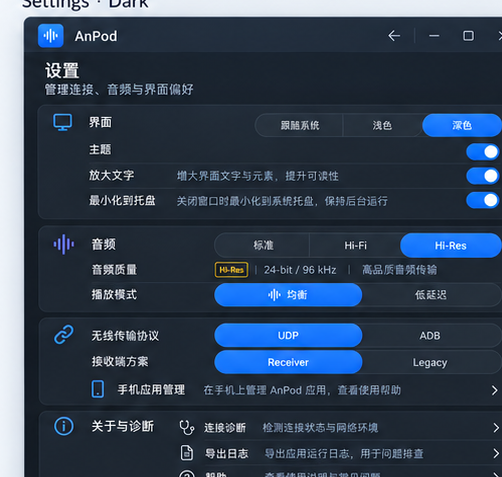

# AnPod PC UI/UX 重构实施规划 v2 · Soft Minimal（方案 A）

> **用途**：包含已选定效果图与可交给 Codex 执行的主界面、设置及弹窗实施级规格；仅重构 Windows PC 端 UI/UX。
> **本文档版本**：v2 / 2026-10-23（在已确认视觉方向上扩展逐组件结构与交互，不代表软件已实施）。
> **强制阅读顺序**：第 1 节图片 → 第 2 节事实基线 → **第 4.5–4.14 节详细实施规格** → 第 6 节实施阶段 → 第 7 节验收。  
> **基线核查日期**：2026-10-22  
> **仓库**：https://github.com/sanren1/AnPod/tree/dev  
> **固定基线**：`dev@ffea50f824e1ae464dc937d191660783870a3ddb`（读取时的分支 HEAD；执行前应重新确认 SHA）  
> **当前 PC 版本**：`1.10.14`；Android Receiver `0.17.6-v3-flow-candidate / code 40`，尚未宣称实机验证。  
> **视觉方案结论**：用户已从 A/B/C 三套视觉风格中选择 **A：柔和极简 Soft Minimal**，不再将风格选型作为待办。设计参考以 [Twinkle Tray](https://github.com/xanderfrangos/twinkle-tray) 为主，辅以 [EarTrumpet](https://github.com/File-New-Project/EarTrumpet) 的直观性和 [Files](https://github.com/files-community/Files) 的设置分组。  
> **本规划与原规划关系**：`AnPod_UI_UX_Plan/plan.md` 已实施的流程精简是既有成果，本文件规划**后续 PC 视觉与交互呈现重构**，不重复、推翻既有决定。  
> **修改边界**：不经单独审议，不修改协议、音频引擎、设备绑定、Receiver Android UI、签名发布及恢复策略。

---

## 0. 首要结论

**本次 v2 的核心补充**：第 4.5–4.14 节提供完整主界面与设置页结构、设置项真实字段绑定、每种弹窗关闭/键盘/滚动/错误/禁用规则、状态矩阵、响应式尺寸与 Codex 分批交付契约。**这些文本规格是功能行为的最高级 UI 说明**，效果图只作为视觉参考。

**保留 Tauri 2 + React 19 + TypeScript + Vite + Rust；增量引入 Motion 用于少量共享布局/弹性动画；以现有 CSS variables 为起点建立设计 Token 和组件样式，不建议全量引入 Tailwind/shadcn 后推倒重写。**

界面目标为 **AnPod Soft Minimal**：小而清楚的“连接优先”音频控制面板。视觉上采用中性石墨灰/浅银灰、低饱和蓝灰强调色、轻量分组和少量动画；UX 上让用户在几秒内看清“连接哪个手机、用什么路径、当前是否真正传音、下一步该做什么”。**保留上一版的主屏/设置页基本布局，不将 UI 改造成复杂仪表盘。**

### 明确不做

1. 不把 420×590 的紧凑应用改造成必须依靠侧边栏的大型仪表盘。
2. 不为视觉效果修改 `src-tauri/src/state/`、USB/UDP/AOA、安全/认证或音频采集逻辑。
3. 不为了统一命名重新定义后端 `Snapshot.state`、增添第二套连接状态机。
4. 不伪造波形、电平、96 kHz/24-bit、延迟或音频播放成功状态；不存在可靠 telemetry 时展示“未确认”。
5. 不默认启用自定义无边框窗口、透明 Acrylic 或高开销全窗口实时模糊。
6. 不强制引入 Redux、全量 React Router、Tailwind、shadcn/ui、GSAP、Lottie 等非必要依赖。
7. 不改变用户已确认的名称 **USB Direct、兼容方式**，保持音质三档 **标准 / 高保真 / Hi-Res**；不要加入隐式降档、自动 SRC。
8. 不修改手动断开后不自动重连的规则；意外断连沿用既有有限恢复语义。

---

## 1. 已选定效果图与设计落地要求

> **重要：本节的四张效果图是风格与布局意向稿，不是 GitHub 当前运行界面，也不是功能验证截图。** 图片由设计工具生成，可能包含尚未获得的数据、演示设备名、夸大的音质以及与真实交互不一致的控制项。真实实现应遵守下面的“效果图与功能映射”规范，而非逐字逐图照搬。

### 1.1 方案 A · 四视图总览（主界面/设置页 × 浅色/深色）


*图 1：本项目用户已选择的第一组 Soft Minimal 效果图。上排是主界面（浅色、深色），下排是设置页（浅色、深色）。方案方向固定，细节在开发中按真实数据与窗口尺寸校正。*

### 1.2 主界面效果图

| 浅色主题 | 深色主题 |
|---|---|
|  |  |

**主屏设计冻结项**：顶部品牌与设置入口 → 设备简要信息 → USB/无线切换 → USB 模式时的 ADB/USB Direct → 真实状态与唯一主按钮 → 播放模式 → 帮助/诊断底栏。主屏常用操作必须一直可见，设置入口不必滚动寻找。

### 1.3 设置页效果图

| 浅色主题 | 深色主题 |
|---|---|
|  |  |

**设置设计冻结项**：沿用“界面/音频/连接/关于与诊断”的清晰分组。设置项左文字右控件；必要时加一行短说明。保留现有高级设置的默认折叠逻辑和可用性门槛。建议在当前小窗内使用可滚动页面/对话框而不是强行一次显示所有项目。

### 1.4 效果图与真实功能映射（实施时强制遵守）

| 效果图中的元素 | 真实实现要求 |
|---|---|
| `Google Pixel 8 Pro`、手机实物图 | 仅为演示；使用当前 `Snapshot` 中已确认设备名/设备信息。无设备时展示空态；默认使用 Lucide 手机线性图标，不新增机型图库。 |
| `Android 14` | 仅在 `sessionAndroidVersion` 或当前设备已有字段可确认时显示；未知则省略。 |
| `电量 78%` | 当前 PC 快照无可靠电量字段；**禁止显示虚构电量**，除非未来以独立功能提案新增遥测。 |
| `Hi-Res`、`24-bit / 96 kHz` | 选择的音质档位和**实际协商格式**是两回事。主屏不许预填 24-bit / 96 kHz；真实值只在经过校验的字段存在时显示，否则不展示或写“未确认”。 |
| “已连接，等待播放” + “播放到手机” | 只是展示状态之一；必须使用已有 `Snapshot`、`readableStatus`、`runMainAction` 派生出的实际状态和按钮文本。USB Direct / 无线等待 / 已播放时的动作不同。 |
| 蓝色的所有已选按钮 | **实现中应降低饱和度**，视觉焦点只给唯一主按钮；分段选择器可使用浅蓝灰选中底色。深色与浅色的内容语义完全相同。 |
| 设置页“播放模式”行 | 主屏已有该选项；不为了对齐效果图增加新的设置存储，若设置页重用必须复用原业务接口与确认规则。 |
| `Receiver / Legacy` | 视觉稿为内部英文占位；实际继续采用仓库已确认的用户友好文案“播放方式”及“兼容方式”等，不退回暴露内部技术名称。 |
| “导出日志” | 不能因为效果图有按钮就新增日志导出 API；优先使用现有诊断页的复制/导出路径，若不匹配则移除此行或改为跳转诊断。 |
| 两档主题效果图 | Light/Dark 使用同一 DOM 结构、同一交互逻辑、同一状态字段，不准出现主题导致的功能差异。 |
| 图中标题栏按钮 | 保留当前 Tauri 原生窗口控制与系统行为；不为了还原效果图强制修改 `decorations` 或重做 Windows Snap Layout。 |

### 1.5 如何使用这些效果图

- **设计参考**：图 1 用于整体布局和明暗色彩验收，图 2–5 用于局部间距、对齐和控件比例评估。
- **图片存储**：所有图片与 Markdown 同包，使用相对路径 `figures/figure-XX-*.png`；完整解压后用 VS Code / Typora / Obsidian 等阅读器打开 `plan.md` 即可查看。
- **不作为自动化测试的金标准**：由于图内文本和信息含演示/生成内容，不要求像素级匹配。正式验收必须使用真实代码在同尺寸下截图，核对语义、可访问性、响应布局和业务正确性。

---

## 2. 代码核查与事实基线

### 2.1 最近提交与历史规划

- `ffea50f`（2026-10-22）：`Record completed UIUX review and local 1.10.14 delivery`；改动为 `AnPod_UI_UX_Plan/plan.md`、`plan_dev.md` 文档记录，并非全新 UI。
- `27c7c60`：修正可选绑定恢复选择兼容性（`App.tsx`）。
- `1de5c90`：主界面无线请求轮询、取消网络连接等。
- `3dfb08c`：登记已签名 Receiver 40。
- `29e7ef3`：无线等待生命周期和连接设置简化。
- 之前的 `AnPod_UI_UX_Plan/plan.md` 显示：主屏设备/连接区域整合、首次设置、连接途径合并、常用/高级设置分层、错误与停止/取消交互已经收敛。上述行为必须保留。
- 代码曾通过浏览器模拟及构建检查；**三链路真机、Windows 防火墙弹窗/切网、热插拔、实际音频格式与长时间稳定性仍需实机验证，不能视为已通过。**

### 2.2 当前工程结构

| 部分 | 代码 | 基线观察 | 重构策略 |
|---|---|---|---|
| 主屏/事件/操作 | `frontend/src/App.tsx`（约 999 行） | UI 与连接调用协调混在一个组件中 | 先提纯展示数据和展示组件，不迁移连接状态机 |
| 全局样式 | `frontend/src/index.css`（约 354 行，较多压缩单行规则） | 已有主题 CSS variables；CSS 类名与测试选择器耦合 | 分阶段拆主题/基础/组件 CSS，保留兼容类名 |
| 运行时文案/状态 | `frontend/src/appRuntime.ts` | `readableStatus` 等已存在 | 复用，提取只读 PresentationModel，严禁推断不存在的音频数据 |
| 类型 | `frontend/src/appTypes.ts` | 含设备、设置、状态、诊断信息 | 类型只读复用，不扩后端协议 |
| 无线连接/管理 | `components/NetworkReceiverDialog.tsx`（约 685 行） | 窗体承担许多步骤，且包含状态生命周期 | 初期只替换视觉子组件，不搬动监听/取消/认证逻辑 |
| 初次设置 | `components/NetworkSetupWizard.tsx` | 已有 3 步流程 | 步骤条、反馈和间距重做，不改变跳转条件 |
| 设置 | `components/SettingsDialog.tsx` | 常用设置+高级折叠，三档音质 | 改为视觉分组/分段控件，保留禁用逻辑与实际格式展示 |
| 弹窗基座 | `components/Modal.tsx` | `<dialog>`、Esc、外部点击约束 | 优先保留原生 dialog 语义与关闭规则，谨慎增加动效 |
| 诊断 | `components/DiagnosticsDialog.tsx` | 有遥测、详情、复制/导出 | 信息层级调整，不覆盖隐私脱敏与真实值 |
| 配置 | `src-tauri/tauri.conf.json` | 主窗口 `420×590`、最小 `360×500`、可缩放 | 保留紧凑尺寸；扩大布局为增强模式而非强制 |
| 运行/托盘 | `src-tauri/src/main.rs` | 具有窗口显示、关闭转托盘逻辑 | 不因自定义标题栏破坏此行为 |
| 前端回归 | `tests/AnPod.Frontend.Check.cjs` | Playwright mocks，大量现有 CSS/DOM 选择器 | 测试先迁移语义选择器，避免重构时失去防线 |

现有 `frontend/package.json` 仅含 React、Tauri API、Lucide、二维码组件及 TypeScript/Vite 等基本依赖。暂无 Motion、Tailwind 和完整组件库，因此应增量添加。

### 2.3 原有状态必须被准确展示

- `noDevice`：无手机 / 等待连接（不能展示已连接）。
- `unauthorized`：需要 USB 调试授权。
- `ready`：设备就绪，但未证明在播放。
- `connecting`：发起连接中；必须保留取消。
- `connected`：连接存在，**不是**正在传音。
- `phoneReady`：手机就绪/等待播放，**不是**已经收到音频。
- `streaming`：流会话状态；PC 只有在 `playbackDiagnostics?.playbackAdvancing === true` 且满足既有条件时才能明确表述“播放进度已确认”。
- `paused`：暂停，不等于错误。
- `reconnecting`：有限恢复中，不应该出现不可取消的无限动画。
- `managementOnly`：仅管理连接，不是音频传输成功。
- `error`：可执行错误摘要、详情及恰当恢复动作。
- `wirelessConnectionOffers.active`：监听中/等待手机请求，和“正在连接”不是同一状态。

**强规则：UI 视觉状态应来自现有 snapshot 和经核查的派生函数。动画状态只能消费实际状态，不能反向推动连接、启动监听或触发后端操作。**

---

## 3. 视觉定位与布局

### 3.1 设计风格

- 名称：**AnPod — Soft Minimal（方案 A）**。
- 关键词：低干扰、简约、直观、弱卡片化、中性灰底、少量蓝灰强调、轻微阴影、统一分段控件、明确的连接状态。
- 浅色：柔和银灰白底、接近白的分组表面与清晰深灰字；深色：中性石墨灰而非深蓝/纯黑。背景基本无渐变，分组以色差/留白为主，避免一层套一层的面板。
- 状态色：成功/播放绿色、准备/连接蓝色、等待/恢复琥珀色、故障红色；颜色必须搭配文字或图标，避免仅靠颜色判断。
- 材质：默认不透明、低对比度。不要为了玻璃效果而加全窗口模糊；仅将系统 Mica 作为可选的后置实验。Win10 和降级环境必须可直接使用。
- 不加入霓虹、强阴影、蓝色荧光、背景光斑、大面积玻璃、装饰性波形或没有数据来源的延迟/电量指标。

### 3.2 设计 Token（建议基线，可在静态 UI 样机阶段微调）

| 类别 | 建议 |
|---|---|
| 间距 | 4 / 8 / 12 / 16 / 24px 分级 |
| 圆角 | 行内控件 8–10px、分组背景 10–12px、主操作 10px；分段选择器整体胶囊；减少过大的“气泡卡片” |
| 字体 | Segoe UI Variable / Segoe UI / system-ui，保留中英混排与系统缩放 |
| 文字层级 | 主标题 20–22、区块 14–15、正文 13–14、辅助 11–12px；避免主要信息低于 12px |
| 动画 | hover 100–140ms；内容切换 150–220ms；共享背景/克制弹性 180–280ms |
| 动效曲线 | 常规 ease-out，胶囊 spring；不可产生大幅回弹和误触 |
| 对比度 | 正文、按钮、状态至少以 WCAG AA 为目标，实测验证 |
| 点击热区 | 常用交互建议不小于约 36–40px，危险操作清晰间隔 |

### 3.3 主屏信息层级（420×590 基本窗口）

```text
┌───────────────────────────────────────┐
│  [AnPod 图标] AnPod           [设置]   │  顶栏：品牌、设置
├───────────────────────────────────────┤
│                                       │
│   ┌────────── 设备卡 ──────────────┐  │
│   │ [手机图标] 目标手机       [⌄]  │  │  设备信息/选取/首次设置
│   └───────────────────────────────┘  │
│                                       │
│   连接方式                            │
│   [       USB       |      无线      ] │  │  流动胶囊选择器
│   [    ADB    |   USB Direct   ]      │  │  仅 USB 时出现
│                                       │
│   ● 已连接 / 正在播放                 │  │  真实状态 + 一句下一步
│   [       连接手机 / 停止播放       ] │  │  唯一主操作
│   等待手机确认 / 已连接，尚未播放      │
│                                       │
│   播放模式               均衡       ▾ │  │  折叠/默认状态复用既有规则
│   [        均衡  |  低延迟       ]    │
│                                       │
├───────────────────────────────────────┤
│ [帮助]                     [诊断] vX │
└───────────────────────────────────────┘
```

注意该图是**布局示意**，并非实际状态截图。真实内容根据 USB/无线、授权、绑定、音频播放和错误条件呈现，不要求所有栏目在同一状态同时显示。

### 3.4 四种主屏视觉场景

**A. 未连接 / 首次使用**：展示单一醒目的设备准备卡、USB/无线入口、一句下一步提示；“首次设置”明显但不和“连接”争抢视觉优先级。USB Direct 的必要配置和系统影响仍应可见。

**B. 已连接、未播放**：手机卡/连接标签稳定，状态突出“已连接”，主操作按现有规则决定连接/播放；绝不显示虚假音频波形或“正在播放”。

**C. 正在播放**：状态标题突出“正在播放到手机”，辅助区域展示已确认的连接方式、可用时显示真实协商格式；保留可立即停止的主按钮。没有可信振幅数据，不新增所谓实时音柱。若确需新增波形必须另立范围、核实数据来源及开销。

**D. 错误 / 恢复**：错误卡使用简短可执行文本、清晰重试/取消或排查入口；详情折叠；不中断地保留当前设备/网络上下文；恢复中展示有界反馈。

### 3.5 窗口尺寸策略

- 保持默认 `420×590`、最小 `360×500`，先以 CSS 响应适配，避免一开始改 Tauri 窗口属性。
- 视觉样机针对 360×500、390×600、420×590、480×700 及最大化等窗口测量。
- 在高度不足时主体纵向可滚动，底部帮助/诊断与主操作不相互遮挡；弹窗可滚动且能看到确认和取消。
- 仅在测试通过后考虑为“大窗口”设计自然扩展布局；不引入桌面侧边栏作为第一阶段前提。

---

## 4. 交互与动效设计

### 4.1 推荐先实现的 8 个组件

1. **AppHeader**：品牌、设置入口、统一顶栏尺寸、必要时显示简短连接徽标。
2. **ConnectionStatusHero**：状态、真实设备/连接提示、等待/连接/暂停/故障反馈；只接收只读 PresentationModel。
3. **DeviceCard**：手机名、连接路径、选择器、首次设置；保持既有所有禁用/授权条件。
4. **FluidSegmentedControl**：USB/无线、ADB/USB Direct、均衡/低延迟等；Motion `layoutId` 共享选中背景，不改变原有 `setOption` 与确认逻辑。
5. **PrimaryActionButton**：主按钮状态、加载视觉、禁用、取消；点击始终绑定现有 `runMainAction`。
6. **DisclosureSection**：播放模式、设置高级项等，保留 HTML 可访问性和 focus 流程。
7. **DialogShell / FeedbackToast**：统一弹窗边框、遮罩、标题、内容间距与错误表现；不修改 `Modal` 外部关闭/ESC 的逻辑约束。
8. **SettingsRow / AudioQualityGroup**：常用配置和三档音质，仅用既有数据与禁用规则；请求档位与实际协商格式分开展示。

### 4.2 动画原则

- 新增 `motion`，优先用于“切换选择器滑动”“状态卡文案切换”“展开卡片高度过渡”“轻量提示出现/消失”。
- CSS transitions 用于 hover、颜色、边缘与阴影。禁止音频进度或网络数据频繁触发完整布局动画。
- 状态渐变：`idle → connecting` 可柔和淡入；`connecting → connected` 瞬时更新核心状态文案，装饰动画可以延后；`error` 必须立即显示，不延迟可操作性。
- 离线、网络等待中的呼吸动效只是一种**等待视觉**，不能暗示数据正在传输；真实失败立即终止。
- 尊重 `prefers-reduced-motion`：禁用 spring、位移与缩放，仅保留即时状态变更。
- 切换 USB/无线及播放模式若触发原有确认，在**确认成功之后**才允许选中态反映已生效设置，不进行乐观切换。
- Modal 开关不得破坏焦点捕获、Esc、焦点返回、滚动锁、外部点击以及网络流程清理。

### 4.3 设置与诊断

- 当前 `SettingsDialog` 已按常用/高级分层，不引入导航层级回退；**视觉分组以效果图 A 的“界面 / 音频 / 连接 / 关于与诊断”为主**，但高级音频/连接项仍保留既有折叠、禁用与业务逻辑。避免在 420×590 小窗口强行塞入整张效果图。
- 音质保持 `standard / hifi / hires`，显示三档对比卡；在 ADB 模式中既有不可用条件继续禁用高级档，并显示原因；**绝不能自动选用未被用户确认的降档**。
- “实际传输格式”“Windows 混音格式”“Android 输出格式”是独立概念；未知字段按未知展示，且不要把容器位深误当有效位深。
- 诊断页保留全部数据、脱敏、复制/导出能力；一般用户默认只看设备、连接、播放状态和简短错误，技术详情二级展开。

### 4.4 无线、AOA 与首次设置的约束

- `NetworkReceiverDialog` 目前包含无线候选、监听、恢复、设置和应用管理的业务逻辑；**第一轮仅调整其 JSX 子视图和 CSS**。
- 无线监听由当前生命周期集中控制，轮询主屏未主动推送的请求；禁用重复开始、取消等待后端确认、延迟结果 generation 防护均必须保留。
- “点击连接/接受请求”不额外增加第二次确认；中断已有播放才使用现存 `ConfirmDialog`。
- `NetworkSetupWizard` 3 步保持原来前置条件、设备授权和安装包验证。
- USB Direct 的 Android 7+ 门槛、已验证机型限制、全局 ADB server 停止的明确许可、AOA 配件授权、物理模式切换提示不能被柔化或藏到危险动作之后。
- 改造视觉后至少覆盖“找不到设备 / 多个候选 / 离线 / 未配对 / 版本不兼容 / 防火墙权限 / 用户取消 / 后端返回迟到结果”等分支。

---

### 4.5 详细 UI/UX 执行规格：全局结构与不得违反的规则（Codex 必读）

本节到 4.14 是**实施级规范**，其优先级高于效果图中偶然出现的图标、演示数值与标签。若与源码存在事实冲突，以执行时的 `dev` 最新源码和已验证业务行为为准；必须记录差异而非猜测。**仅改变视觉层、布局及可访问性；不得通过视觉组件改变会话状态。**

#### 4.5.1 UI 分层与唯一事实来源

```text
Tauri/Rust 原有业务命令及 anpod://snapshot 事件
                        ↓
App.tsx（唯一业务协调者：监听、请求、确认、取消、generation、panel）
                        ↓
现有 appRuntime.ts + 只读 deriveMainView(snapshot, localUiFlags)
                        ↓
AppShell（顶栏 / 主内容滚动区 / 底栏）
   ├─ MainView（设备区 / 方式选择 / 状态与主动作 / 播放模式）
   └─ 现有 dialogs（Settings / Device / Network / AOA / Pair / Help / Diagnostics / Confirm）
                        ↓
纯展示控件（SettingsRow、SegmentedControl、StatusIndicator、DialogSection……）
```

- `Snapshot`、已有运行中标志、已有状态派生函数为信息来源；`loading`/`pending` 是真实操作状态，**动画进度不是后端操作进度**。
- 所有**业务动作**继续调用 `App.tsx` 当前的 `runMainAction`、`setOption`、`openAoaDialog`、`startNetwork`、`cancelNetworkStart`、`setOutput` 等原有路径；展示子组件不得引入 `invokeApp`、`listen`、额外的网络轮询或重试定时器。
- 顶栏在 WebView 内容内只放产品标识与设置按钮；**Windows 最小化/最大化/关闭仍由 Tauri 原生装饰呈现**。效果图中的 Windows 控制按钮只是示意，不允许在 DOM 内再画一套造成重复标题栏。
- 主窗口当前 `420×590`、最小 `360×500`、`resizable: true`。P1–P4 不修改这个配置。设置及其他弹窗仍使用同一 Tauri 主窗口内的原生 `<dialog>`，不新开 WebviewWindow。
- 视觉规范不得改变现存设备选取入口、首次设置入口、播放模式折叠、手机应用管理入口和帮助/诊断可达性。若需要交互流程变化，另起功能 PR，不能混在样式 PR 中。
- UI 所有中文通过现有 `strings`/本地化文件提供，英文版对应增加或复用翻译 key；设计图中文字不是硬编码凭据。

#### 4.5.2 Soft Minimal 统一视觉语言

| 元素 | 浅色主题建议 | 深色主题建议 | 落地规则 |
|---|---|---|---|
| 页面底色 | `#F3F5F7` | `#191D21` | 使用中性灰，不要大面积蓝色渐变 |
| 一级分组面 | `#FFFFFF` | `#24292E` | 一级容器最多一层；内部分隔线优先于卡片套卡片 |
| 辅助容器/未选项 | `#EBEFF2` | `#31383E` | 用背景色差表达层次，无立体按键质感 |
| 主文字 | `#20272F` | `#F0F3F5` | 关键状态/设备/主按钮优先级最高 |
| 次文字 | `#5F6D78` | `#AAB6BF` | 11–13 px 次文字须做对比度检查 |
| 分隔线 | `#DEE4E8` | `#394148` | 1px 细线，必要时用留白代替 |
| 强调色 | `#547FAD` | `#86A9CF` | 选中胶囊使用**柔和底色**，不把每个选项涂成亮蓝按钮 |
| 强调底色 | `#E4EDF5` | `#35495B` | 选中状态必须还可由文字/aria 区分 |
| 成功/已播放 | 适中绿 | 适中绿 | 与纯粹“已连接”区分；不使用持续闪烁 |
| 等待/恢复 | 柔和琥珀 | 柔和琥珀 | 文字必须同步解释状态 |
| 故障 | 低饱和红 | 低饱和红 | 恢复操作不依赖颜色辨认 |

以上 HEX 是**视觉起始 Token 而非已经通过对比度审计的结果**；对比度检测不通过时，以可读性优先微调，不擅自将颜色视作验收硬值。

- 字体：`Segoe UI Variable` → `Segoe UI` → `system-ui`；主标题建议 18px/600，卡片标题 14px/600，正文 13px/400，辅助信息 12px/400。大字模式应通过 scale token 增量放大，不依赖布局绝对高度。
- 间距：按 `4, 8, 12, 16, 24` px；同一块内部 8px，区块间 10–12px，页面左右 14–16px，禁止任意魔法数累积。
- 圆角：主窗保持 Windows 原生外框；一级分组 10–12px，输入及按钮 8–10px，胶囊容器 10–12px，选中游标 8–10px。**不追求越圆越好**。
- 阴影：正常一级卡不加或只用 1 层弱阴影；弹窗有轻量浮层阴影。禁用霓虹光圈、层层渐变、发光边缘及炫彩光效。
- 图标：沿用 Lucide；顶栏 17–18px、行项目 16px、辅助 14px，保持 stroke 一致。手机用抽象线图标，不添加机型图片、壁纸图或电量图标。
- 禁用态：降低对比但保留文字可辨；鼠标 hover 不替代 `:focus-visible`；禁用理由紧贴对应设置项，不全局弹 Toast。
- 主按钮是唯一高对比实心强调控件（通常 40–44px 高），危险/停止状态不得只靠不同颜色表达。
- 允许普通 Windows 10/11 WebView2 环境使用；Mica 和 `backdrop-filter` 不是达到该风格的前置条件。

### 4.6 主界面：逐区域结构、尺寸和交互规则

#### 4.6.1 主屏信息架构与 DOM 顺序

```text
<AppShell>
  <AppHeader> 品牌 AnPod / [打开设置]                 固定可见
  <main aria-label="AnPod 主界面">                   可纵向滚动
    <DeviceSummarySection>                           一级分组 1
      目标设备图标 / 名称 / 有来源的连接路径或状态
      设备选择入口 / 首次设置辅助入口（条件允许时）
    </DeviceSummarySection>
    <ConnectionModeSection>                          一级分组 2
      连接方式：USB | 无线
      有线模式：ADB | USB Direct（仅选 USB 时出现）
      与当前选择相关的一句话提示（必要时）
    </ConnectionModeSection>
    <ConnectionActionSection>                        视觉最高优先
      实际状态与一行可执行说明
      [唯一主操作按钮：连接/播放/停止/取消/重试]
      错误详情/接收请求等待/手机应用升级（按业务条件）
    </ConnectionActionSection>
    <PlaybackModeDisclosure>                         次要控制
      播放模式  当前值  [展开/收起]
      [均衡 | 低延迟] + 一行差异说明
    </PlaybackModeDisclosure>
  </main>
  <AppFooter> [帮助] / 版本 / [诊断]                 固定可见
  <ExistingDialogOrToast .../>                        顶层浮层
</AppShell>
```

**阅读顺序与键盘 Tab 顺序必须一致**。不要把主按钮视觉放在设备选取之前但 DOM 放在后面；不额外加入“仪表盘、设备历史、波形、电池”等装饰模块。

#### 4.6.2 默认窗口内的布局预算（非必须刚性高度）

| 容器 | 推荐高度/间距 | 行为 |
|---|---|---|
| AppHeader | 52–56px | Logo 左，设置右；不可滚动；不含伪造的 Win32 关闭按钮 |
| Main 内容区 | 剩余弹性高度 | `min-height:0; overflow-y:auto; overflow-x:hidden`，滚动条仅必要时出现 |
| 页面左右边距 | 14–16px；窄窗约 12px | 文本优先，防止水平溢出 |
| 设备摘要 | 内容最少高度约 62–76px | 名称可换行至 2 行；长序列号截断但有可访问全称 |
| 连接方式 | 每行触达高度约 38–42px | 两级选择仅 USB 时同时显示；不强行占空白 |
| 状态与主操作 | 一行主状态 + 1–2 行描述 + 40–44px 主按钮 | 故障/等待扩展内容自然撑高，不裁掉文字 |
| 播放模式 | 折叠头 40–44px，展开含 38–42px 选择器 | 当前 `details` 默认展开的业务表现保持，用户可折叠 |
| AppFooter | 38–42px | 帮助、版本、诊断始终可见；内容过多时折中隐藏非必要副信息 |

在 `360×500` 下不允许用绝对定位把状态区与播放区硬压在同一高度；主屏滚动是可接受行为，**主动作应尽可能位于首屏**，不能为此删除必须看到的真实状态或授权提示。`420×590` 优先完整展示关键路径，额外的错误/升级提示出现时允许滚动。

#### 4.6.3 设备摘要（DeviceSummarySection）

- **首行**：左侧 20–24px 线性手机图标，中间设备名（`device.displayName`、`snapshot.deviceName` 或仓库当前派生逻辑），右侧 Chevron；整块设备选取区有完整点击热区，操作按钮单独成为 sibling，避免嵌套 `<button>`。
- **次行**：真正的连接方式 `USB / 无线 / USB Direct` 或准确的待选状态；活跃会话显示实际连接方式，不以用户当前拟切换方式冒充已建立会话。
- **空态**：未找到设备时标题按现有文案“未发现手机/选择手机”呈现，辅助文案明确下一步；USB 未授权说明需在可见帮助/弹窗中可达。不得渲染空手机照片。
- **首次设置**：在符合当前条件时保留显式文字入口，颜色为次级；不改成仅一个难找的 `…` 菜单；若当前操作不可用，禁用并保留说明。
- **设备切换**：连接进行中/会中断会话时调用原有确认，不因卡片动画直接切换。选中提示只在后端与 `Snapshot` 同步后变化。
- **长内容**：中文设备名可换行到 2 行；英文型号/序列号设 `min-width:0; overflow-wrap:anywhere`，避免挤压右侧操作。
- **不要显示**：未采集的手机电量、未经证实的 Android 版本、随机机型封面；不强制引入头像图库。

#### 4.6.4 连接方式与有线模式（ConnectionModeSection）

| 情形 | 控件显示 | 行为要求 |
|---|---|---|
| 选择 USB | `USB` 选中 + `ADB / USB Direct` 次行 | `USB Direct` 与 `ADB` 的选择继续走当前 wiredMode 设置/确认流程 |
| 选择无线 | `无线` 选中，仅一行方式选择 | 不展示有线子选择（无空白占位）；无线协议 UDP/ADB 的复杂选项仍留高级设置 |
| 已连接、操作会中断音频 | 保留当前生效模式选中 | 使用已有确认弹窗，不允许切换时预先移动游标表示成功 |
| `controlsDisabled` 或监听待处理 | 控件禁用并保留可阅读选项 | 不吞掉点击反馈；说明为何当前不可切换 |
| 切换失败 | 仍显示真实 `Snapshot` 选中值 | 现有通知机制报错；不得发生“UI 已切换、业务未切换” |

分段控件的 selected state 由 `value` 驱动，不由自有内部状态缓存决定；推荐共享底色过渡 160–240ms，优先 `transform`，无动画模式下即时移动。两级控件都保持相同视觉语言，但**不等同于同一设置项**。焦点导航使用原生 button + `aria-pressed`（保持现存测试语义）；不要未经测试换成需要箭头键规则的 tabs。

#### 4.6.5 状态与主操作（ConnectionActionSection）

- **内容区**：左/上为状态色点与 `readableStatus(...)` 派生状态标题，下方最多 1–2 行说明，唯一主按钮宽度占满卡片可用区域。
- **主按钮**：必须直接绑定当前 `runMainAction`，`label` 与 `disabled` 使用原有 `mainActionLabel/mainActionDisabled` 结果。绝对不要在纯 UI 组件中再实现一套连接分支。
- **连接中**：明确显示“连接中/取消连接”；按钮是否可取消按现有 `networkStartPending`、`cancelPending`、`cancellingConnection` 等规则；显示转圈不等于强制禁止取消。
- **无线等待**：区分“监听手机请求”和“正在建立音频会话”，显示一个确定的等待说明；真实请求到达才显示可处理候选，多个请求须明确选取。
- **播放中**：主按钮及时显示“停止播放”，保持默认可达；音频实际前进未确认时用中性表述，不以装饰动画假装收到了音频帧。
- **错误态**：常显一条可执行摘要，详情在小型折叠区域（已有 `ErrorDetails`），具备已有重试/断开/手机应用升级入口；不要用 Toast 代替持续性错误。
- **暂停/重连/仅管理**：不能用统一绿点 +“已连接”模糊区分；每一种均有独立短标题与不同说明（详见 4.9）。
- **性能**：一次 `snapshot` 更新不要引起不相关模块的位移动画；`playbackDiagnostics` 高频数据不要触发整窗 spring。

#### 4.6.6 播放模式与底栏

- 保留原有可折叠 `<details class="mode-disclosure">` 行为，标题行“播放模式 + 当前值 + Chevron”在折叠状态仍能识别当前设置；默认展开策略沿用现有实现，不新增持久化。
- 展开后两个选项 `均衡 / 低延迟`（以仓库已有实际文案为准），选择受 `canChangePlaybackMode/canChangeModes`、会话能力和 AOA 限制约束。模式切换需要确认时，**只有后端确认生效才能改变选中态**。
- AOA 不支持热切换时必须显示原有说明，不能把限制变成没有原因的禁用按钮。
- 底栏 Help、Diagnostics 维持双侧入口，版本用弱对比文字；窄窗仍保持可点击热区。底栏不做系统级托盘功能替代，不把“退出/关闭”挤到设置。

### 4.7 设置界面：完整信息架构与逐项规格

**强决定：第一轮仍使用现有 `SettingsDialog` + `Modal`（`<dialog>`）呈现。** 效果图中的“独立设置窗口标题栏”只是视觉表现；Codex 不得因效果图把设置实现为单独 Tauri 窗口或强行新增路由。样式可做得如一个小型页面，但 DOM 内只保留一个“设置”标题和现有关闭按钮。未来若有明确需求，再单独评估主窗口内全页视图，而不是本轮引入。

#### 4.7.1 布局、分组、滚动与导航

```text
<SettingsDialog>                                        .modal.settings-dialog
  <DialogHeader> 设置                                  56px（建议）
  <ScrollableDialogBody>                                max-height 以视口为界
    <SettingGroup title="界面">                       常用；默认展开
      主题                   跟随系统 / 浅色 / 深色
      放大文字               [开关]  + 一句说明
      最小化到托盘           [开关]  + 一句说明
    </SettingGroup>
    <SettingGroup title="音频">                       摘要始终可见
      音质（当前选项）       标准 / 高保真 / Hi-Res
      [展开高级/格式信息]    受已有高级设置折叠策略约束
      实际传输/混音/输出格式 [仅原有数据，不伪造]
    </SettingGroup>
    <SettingGroup title="连接">                       常用摘要/高级折叠
      无线协议（高级）       UDP / 无线 ADB 兼容
      播放方式（高级）       用户文案值；不是 Receiver/Legacy 英文硬编码
      手机应用管理           [进入现有管理流程]
    </SettingGroup>
    <SettingGroup title="关于与诊断">                 一般信息区
      连接诊断               [进入既有 DiagnosticsDialog]
      帮助                   [进入既有 HelpDialog]
      版本与隐私说明         简短说明；可复用现有文案
    </SettingGroup>
  </ScrollableDialogBody>
</SettingsDialog>
```

- 若保留当前“常用 / 高级”单个 `<details>` 实现，则使用四个可识别视觉标题对内部行进行分组，**不让视觉稿强制所有高级项默认展开**。首页视图优先快速找到主题、文字、托盘；高级音质/网络仍默认折叠。实际分组与 `<details>` 嵌套结构以避免重复语义和不必要重新挂载为原则。
- 设置弹窗的标题栏固定在其滚动内容上方。滚动范围覆盖所有内容，禁止为每个小卡片制造独立垂直滚动；弹窗底部可见完整最后一项，不与底部阴影重叠。
- 420×590 时弹窗受现有 CSS `width:min(440px,calc(100vw - 28px))` 和 `max-height:min(86vh,700px)` 约束；在 360×500 情况下宽度约 332px、高度约 430px。**不设置按内容无限增高的大弹窗**。可测试性高于强求四组同时在屏幕上可见。
- 行内设置采取**左文字右控件**的语义结构：标题行 13–14px，说明文字 11–12px；单行短控件在右，三选项控件不够宽时**另起一行，占满可用宽度**，不可把文字压成数个字一列。
- 每组标题 14px/600，左侧可用一个 16px icon 但不必每行一个图标；组间靠 12–16px 留白，组内靠 1px 分隔。图标非理解内容所必需。
- 展开高级项、改主题、点击返回均不重置无关设置草稿或后端状态。滚动位置是否保留沿用 React 生命周期和现有弹窗逻辑，不特意增加全局持久化存储。

#### 4.7.2 设置项逐条映射（必须与 `SettingsDialog.tsx` 对照）

| 位置/控件 | 数据来源与现有调用 | 启用/状态条件 | 特别注意 |
|---|---|---|---|
| 界面/主题（3 选 1） | `settings.appearanceTheme`；`onSave('appearanceTheme', value)` | `snapshot.busy` 禁用 | 维持 `System/Light/Dark` 实际枚举；深浅色样式切换不引入第二套主题状态 |
| 界面/放大文字 | `largeText` + `onLargeText(...)` | 沿用现有控制 | 这是现有 UI 状态；**不可假定它已持久化**，不要新增不受控持久化逻辑 |
| 界面/最小化到托盘 | `settings.minimizeToTray`；`onSave` | `snapshot.busy` 禁用 | 只改变可视开关；关闭窗口时原生托盘逻辑不动 |
| 音频/音质 | `settings.audioQuality` + `onSave('audioQuality', ...)` | `busy`、`snapshot.canChangeModes`、`adbQualityOnly` | ADB 模式下高保真/Hi-Res 不可用时必须禁用、说明原因；不得自动降档 |
| 音频/实际格式详情 | `negotiatedAudioFormat`、`windowsMixFormat`、`androidOutputFormat` | 无遥测时显示“未确认/未知” | 这是三个独立指标；有效位深 vs 容器位深不能混用 |
| 音频/播放模式 | 当前主屏已有 `settings.playbackMode` + `setOption('playback', ...)` | `canChangePlaybackMode` 等 | **优先仍放主屏**；如设置中展示该项，必须共享完全相同的处理器/确认逻辑，不能新增第二个 `onSave` 捷径 |
| 连接/无线协议 | `settings.wirelessProtocol`；`onSetOption('wirelessProtocol', ...)` | 原有 `busy`、已连会话中断确认 | 显示 UDP/无线 ADB 兼容，不能新增无依据的“推荐最快”证明 |
| 连接/播放方式 | `settings.audioBackend`；`onSetOption('audioBackend', ...)` | `busy || udpBackendFixed` | 用户文案沿用仓库“播放方式/兼容方式”，AOA/UDP 限制说明不可删除 |
| 连接/手机应用管理 | `onOpenReceiverManager()` | `busy` 时不可进入 | 仍打开既有 `NetworkReceiverDialog` 对应模式，不新造简化管理流程 |
| 关于与诊断/诊断入口 | 复用现有主屏 `setPanel('diagnostics')` 逻辑或经测试的注入回调 | 只读一般可进入 | 原 `SettingsDialog` 目前**没有**该入口，属于展示层新增导航需单独小 PR；不得新增后端 API |
| 关于与诊断/帮助入口 | 复用现有 `HelpDialog` 入口 | 同上 | 可按布局需求保留在主屏底栏而不重复添加于设置；优先消除冗余 |
| 关于与诊断/日志操作 | 现有 `DiagnosticsDialog` 有 `open_logs`、`exportDiagnostics` | 按既有导出状态和出错处理 | 效果图的“导出日志”不等同“导出诊断”；不可直接新设一个不存在的 `export_logs` 命令 |

**设置页明确处理的二处设计稿差异**：设计稿视觉呈现了“音频质量/播放模式/连接协议全部同时展开”和“导出日志独立快捷项”；第一轮应保留原有**高级默认折叠**、现有诊断导出入口，而非为了像素还原虚构功能；必要时将小标题/摘要可视化，点击展开查看已存在的选项。

#### 4.7.3 设置操作反馈规则

- 开关/选择器初始值始终来自当前真实 props。用户变更触发已有 API；请求未完成时相关项禁用并给出局部“正在应用”；结果返回更新 `Snapshot` 后才将持久设置视为成功。
- 命令失败时保留原值，展示现有 `notify`/错误信息，焦点保持在交互元素附近；不把失败吞掉或无声恢复。
- 某项因当前连接状态而不可用：选择器显示禁用、附原因；不要为显示更多蓝色胶囊而把禁用项启用。
- 主题即时改变后的动画只允许颜色过渡 100–160ms；**不可短暂出现浅色底 + 深色字/反之**。系统主题变更沿用已存在的 `matchMedia` 监听。
- 明暗主题**完全相同的信息结构**；开发验收图需保证“浅色选中浅色、深色选中深色”，避免演示图与真实设置不一致。

### 4.8 弹出界面：统一外壳与各类型交互契约

#### 4.8.1 弹窗组件分层与几何约束

所有弹窗共用现有 `Modal.tsx` 的 `<dialog>` 语义、遮罩和原生焦点模型，只更新样式与可复用内容小组件。**禁止先整体换成自定义 `div` 弹层或全量 Radix Dialog。**

```text
<Modal title=... onClose=...>
  ┌ 头部：标题                         [×] ┐
  │ 主要提示/状态摘要（如需要）            │
  │ ─────────────────────────────────── │
  │ 内容滚动区                            │
  │  设备列表 / 步骤引导 / 表单 / 诊断     │
  │  错误摘要 / 详情折叠                  │
  │ ─────────────────────────────────── │
  │ 次操作                         主操作 │
  └─────────────────────────────────────┘
```

| 类型 | 典型容器 | 推荐交互结构 | 滚动/按钮规则 |
|---|---|---|---|
| 极简确认 | `ConfirmDialog` | 标题 + 一句后果 + 取消/继续 | 不额外塞“取消/关闭”第三个按钮；操作进行中遵守 `busy` |
| 设备选择 | `DeviceDialog` | 状态/刷新 → 可选设备列表 → 次级动作 | 列表可滚；设备单选高亮、无结果有解释 |
| 无线连接 | `NetworkReceiverDialog` | 优先简洁路径 → 监听/候选 → 高级恢复 | 必须保留当前监听生命周期、可取消及发现结果真实性 |
| 首次设置 | `NetworkSetupWizard`（嵌套无线容器） | 1. USB → 2. 手机应用 → 3. 绑定 | 保留顺序/前置条件；步骤内容可滚，底部继续/返回可达 |
| USB Direct | `AoaDialog` | 设备/绑定选择 + 可选模式切换危险区 | 特殊授权和风险确认必须靠近危险按钮 |
| 配对 | `PairDialog` | QR/配对码/地址 tab → 字段/步骤 → 主动作 | 切换方式不误操作，6 位码保留输入校验 |
| 手机应用管理 | `ReceiverAppManager`（嵌套无线容器） | 版本状态 → 检查/安装/升级 → 进度/修复 | 按原接收端签名/版本审核，禁用重复操作 |
| 诊断 | `DiagnosticsDialog` | 状态概览 → 详情折叠 → 复制/导出/日志 | 默认简洁；原始技术字段可展开，隐私处理不退化 |
| 帮助 | `HelpDialog` | 与当前连接方式相关的短步骤 | 滚动阅读，关闭明确 |

- 弹窗宽度仍由 `min(440px, calc(100vw - 28px))` 限制，诊断等有较大理想宽度也不得突破宿主窗口；最大高度 `min(86vh,700px)`。在 360×500 与 420×590 下均必须能访问最底部动作。
- 边距：头部左右 16–18px、上下约 14px；内容 14–18px；相邻控件 8–12px。只用一层主要面板，复杂列表采用细分隔线。弹窗首屏必须清楚表述**为何弹出、下一步是什么**。
- 如果“粘性底部按钮栏”可在不挡内容、保留滚动且不影响现有 form submit 时实现，可用于向导/无线；否则继续普通流式 footer，不为效果强制新增 overlay 盖住内容。
- 打开：动画以 120–180ms 透明度/极小位移为主；关闭：优先保证 `onClose` 立即处理取消、监听清理等语义，**不可为了退出动画延时调用原有 cleanup**。
- 只允许一个主 modal 操作上下文；从设置到手机应用管理切换现有 `panel`，不在顶层叠多个业务 modal。风险确认继续由原有 `confirm` 协调。

#### 4.8.2 弹窗关闭、安全与焦点统一规则

1. Esc：继续走现有 `Modal` 的 `onCancel`/`onClose`；正在 AOA 物理切换、安装或不可中断阶段时尊重各 dialog 现有拦截（如 `switching` 不关闭）。
2. 点击遮罩：**仅在真正对话框区域之外**调用现有关闭行为。点击内容空白、列表、进度轨道不得关闭。具体特殊状态仍由调用方的 onClose 负责清理或阻止。
3. 右上角“×”：等价于当前 `onClose`，不绕过正在进行的连接取消或清理逻辑；不能只隐藏 DOM 并让后台任务悬空。
4. 焦点：打开时落在标题或第一个安全交互项；关闭后返回触发按钮（若仍存在）；`Tab` 留在 dialog 中，`Shift+Tab` 反向遍历，`Escape` 可用；错误出现时可将焦点移到有可访问名称的错误摘要，不抢用户输入焦点。
5. 表单提交：主按钮可以由 Enter 触发，但在表单焦点内按 Enter 不能造成重复 `submit`；所有非提交按钮显式 `type="button"`，避免误触 `NetworkReceiverDialog` 的表单提交。
6. 多次点击：busy/pending 的禁用逻辑来自原有状态，视觉 loading 不能作为唯一互斥机制；取消需要等待原有后端确认，不能瞬间当作已取消。
7. 异常与卸载：关闭、切换到其他 panel、窗口退出后原有 generation guard、事件 unlisten、轮询、AOA configuration cleanup 必须持续有效。
8. `prefers-reduced-motion: reduce`：弹窗瞬时出现/关闭，焦点、屏幕阅读器和业务清理结果与普通模式一致。

#### 4.8.3 每种弹窗的可视区域与行为细则

**DeviceDialog（设备选择）**

- 标题“选择手机”；最上方展示“仅当前方式的设备”和刷新入口；主体按行展示设备名、授权/就绪状态、连接方式、是否当前连接（若存在），选中行应有柔和强调底与勾选。
- 不能把“可连接”“已选中”“已连接”统一成一个图标；来自 `device.connectable`、`activeSerial`、`selected` 的状态应可区分。
- 无设备或设备未授权：显示可执行提示（打开 USB 调试授权/刷新/首次设置）；不可用设备行保留可阅读的失败原因。
- 连着其他手机时切换触发原有确认；设备列表 DOM 仍保留现有 `onSelect` 和 `onConnectOnly` 语义。

**NetworkReceiverDialog（无线连接）**

- **默认简洁区（上方）**：当前已保存/已绑定手机（仅可信绑定时这么称呼）、连接状态一句话、唯一主操作；多绑定时按现有条件先选择。
- **监听区（中部）**：显式写明“等待手机连接电脑/正在等待请求”；真实请求列表才出现候选行。请求行显示 endpoint 与“待确认”，**不能把发现的未知 IP 伪装成已验证设备名**；多个请求必须选择后接受。
- **高级恢复区（下方折叠）**：本地网卡、USB 引导、手机 IPv4、手动 endpoint、重新搜索、后台免确认等仍能找得到；不为简洁删除现有防火墙/网络诊断入口。
- 不能因为 UI 展开/折叠来启动/停止监听；沿用 `App.tsx` 当前队列、轮询、generation 和 `NetworkReceiverDialog` 里的局部 state。
- 主按钮的真实含义由现有 `canStart/canAcceptSelectedOffer` 及 `submit` 决定；接受请求与拨号不自行新增一次“是否开始播放”的确认。
- 正在取消、等待后端、发现失败、请求过期、版本不兼容、没有同网段接口、候选不唯一分别有文本反馈；内容区高度自然增长。

**NetworkSetupWizard（首次设置）**

- 三阶段步骤条：`连接 USB → 检查/安装手机应用 → 完成网络绑定`。当前步骤明确，已完成步骤有 check，仅允许回退到按现有业务允许的阶段，不以步骤按钮直接跳过验证。
- 第一步：选择已授权 USB 手机；未授权/无设备需有“刷新设备”和可执行说明；“下一步”只在现有 `serial` 条件成立时可用。
- 第二步：展示真实安装/版本检查结果，安装/升级由已有业务函数发起；正在安装/验证时真实阶段提示可见，失败保留重试与详情。
- 第三步：本地网卡与手机 IPv4 选择、同网段不匹配原因、刷新网络、绑定确认、完成；不自动替用户选择风险较高的陌生网络接口。
- 小窗口下步骤头可一行简写为 `1 USB / 2 手机应用 / 3 绑定`，但屏幕阅读器仍能听到完整标签；若需要更长解释，放在步骤内容，不强迫步骤条换成两行。

**AoaDialog（USB Direct）**

- 分成“直接连接”常用区与“切换 USB 模式”风险区（可折叠）。后者含目标选择、风险说明、需要明确勾选的确认框以及执行按钮。
- 风险文案必须在用户真正点击切换操作之前可见：配件授权、USB 功能变化和全局 ADB server 影响不能因样式重构省略。
- `switching` 中右上角关闭及 Esc 继续遵循当前禁止关闭规则；`starting` 时关闭按现有逻辑调用取消连接，不直接隐藏。
- 可选目标为空/绑定为空时连接按钮禁用且说明原因；切换后仍需重新读取真实设备目标，不凭动画假定已经完成 USB 权限切换。

**PairDialog（配对/添加设备）**

- 顶部 3 个现有模式入口（QR、配对码、地址），尽量复用一组轻量 tab，不新增模式。
- QR：二维码与短步骤同屏、状态反馈明显；取消扫码/配对需要调用当前 `cancel_qr_pairing`/generation 保护。
- 配对码：地址 + **6 位数字**输入验证；非数字过滤和最大长度规则沿用当前代码；焦点、错误原因贴近字段。
- 地址：endpoint 输入与局域网搜索为并列功能，不把“搜索候选”误做自动连接；选择返回的地址后仍用现有连接路径。

**ReceiverAppManager（手机应用管理）**

- 第一行是目标 USB 手机与当前检测状态；第二块“已安装版本 / 可用包 / 兼容性检查”，只展示经代码确认的版本。
- 安装、升级、修复为互斥行动，优先展示**一个当前可执行主动作**，其余次级；保留所有校验与既有反馈，不做没有服务器进度的虚构百分比。
- `ReceiverInstallProgress.stage`（checking/transferring/verifying/completed/failed 等）使用实际枚举驱动进度步骤；未知精确百分比时使用阶段提示而不是任意 75%。
- 绑定重置与后台授权撤销属于可能中断会话的高风险操作，必须保持原有明确确认、禁用条件、结果详情；不允许直接点击列表行即执行。

**ConfirmDialog（中断与安装确认）**

- 内容只保留“标题 + 一句实际后果 + 取消/继续”，沿用 `ConfirmDialog`、`applyConfirmed` 及目前安装特殊说明。
- 默认焦点应尽量落在**取消/非破坏性**按钮；主按钮不可因为蓝色高亮而被自动触发。处理中使用原有 busy guard 阻止重复提交。
- 不用泛用“确定”覆盖所有实际中断文字；仍由仓库现有 strings 映射。

**DiagnosticsDialog / HelpDialog**

- 诊断第一屏为 `实际连接状态 / 实际路径 / 播放模式` 3 条可读信息；技术详情 `<details>` 展开后展示所有原始诊断分组。
- 复制、导出诊断、打开日志仍位于现有技术详情内；路径/失败消息用原有 `exportPath/exportError`；不得把“导出诊断”改标为“导出日志”。
- 错误详情展开后原有技术数据、特殊字符串复制、以及隐私保护（如标识符脱敏）均不得减损。
- 帮助根据传输方式显示当前对应说明；不混入不适用的 USB/无线指引。步骤保持简短但具备文档中的授权/兼容性限制。

### 4.9 UI 展示状态矩阵：Codex 的行为验收基准

**注意**：下表是状态显示规则，**并非要求更改原 `readableStatus/mainActionLabel` 函数的枚举和优先级**。在实际实现中，应记录当前代码对于每一 fixture 的输出，并以原代码为 golden reference；若文案或动作冲突，保留已验证行为并在 PR 中说明。

| 原始状态/额外上下文 | 主区状态语义 | 动效/色调 | 主动作和辅助信息 |
|---|---|---|---|
| `!snapshot` 启动中 | 加载中（不宣称已连接） | 轻量静态骨架/加载图标 | 不呈现可点击的假连接按钮；IPC 异常沿现有处理 |
| `noDevice` | 未找到可用设备/等待选择 | 中性 | 路径由已选择的 USB/无线模式决定；首次设置可达 |
| `unauthorized` | 等待 USB 调试授权 | 琥珀 | 提示手机端授权与刷新，不称设备已就绪 |
| `ready` | 手机/设备已就绪 | 中性或正向 | 主动作完全沿现有 `mainActionLabel`，不暗示已音频播放 |
| `connecting` | 正在建立连接 | 琥珀+克制活动符号 | 保留原有取消行为，避免用户重复点击触发重入 |
| `connected` | 已连接，音频未被确认 | 中性正向 | `output='computer'` 则明确电脑输出；不称播放中 |
| `phoneReady` | 手机端就绪/等待播放 | 中性正向 | 与 `streaming` 分开；可能保持电脑输出 |
| `streaming` + `output='phone'` + `playbackAdvancing===true` | 正在播放到手机/有进度证据 | 低饱和绿，**不造假波形** | 主按钮保持停止；可显示经确认音频格式 |
| `streaming` 但 `playbackAdvancing!==true` | 正在接收/进度尚未确认（依仓库现存文案） | 中性或等待 | 禁止展示“音频正在稳定播放”式断言 |
| `paused` | 已暂停 | 琥珀/中性 | 提示暂停不是失败，保留恢复/停止原有动作 |
| `reconnecting` | 有界恢复中 | 琥珀轻微转动 | 显示已有 `networkRecoverySecondsRemaining` 时的真实剩余时长；不新增 UI 自行倒计时 |
| `managementOnly` | 仅管理连接，音频不兼容 | 琥珀提示 | 提供现有更新手机应用/断开等行动，不宣称能播放 |
| `error` 或 `cleanupPending` | 操作未完成 / 待清理 | 低饱和红 | 可见的一句可执行摘要，详情折叠，按现有规则重试/断开 |
| `wirelessConnectionOffers.active` 且无 request | 等待手机发起连接 | 琥珀/中性 | 主按钮可能是停止等待，不要显示成“正在拨号连接” |
| 发现一个手机 request | 手机请求待确认 | 中性/待处理 | 按现有条件自动/手动流转，不能把未验证 endpoint 称为配对手机 |
| 发现多个 request | 需要选择请求 | 琥珀提示 | 高亮所选候选，禁止默认接受不确定设备 |
| `receiverOperationBusy` / cancel pending | 安装/取消处理中 | 进度或处理中 | 禁止重复提交；若可取消按原有能力，不按动画状态推断 |

视图状态、当前选择和实际会话路径必须分开：拟选择 USB ≠ 当前会话通过 USB；已连接 ≠ 音频前进；用户选择 Hi-Res ≠ 96 kHz 协商成功；系统宣称监听 ≠ 已有手机请求。

### 4.10 微交互与动画细则（精简，不炫技）

| 事件 | 视觉响应 | 交互守则 |
|---|---|---|
| 鼠标 hover | 背景微亮或描边色差，100–140ms | 不使卡片漂浮/缩放；无 hover 设备仍可用 |
| 按钮 press | 轻微颜色加深，≤100ms | 不做大幅缩放或震动 |
| Segmented 选择 | 选中底色/胶囊位置过渡约 180–240ms | `value` 来自已确认真实状态；会中断操作时等待确认后变更 |
| USB → 无线子行消失 | 内容高度或透明度 150–200ms | 不能覆盖下一块主按钮；reduce-motion 即时 |
| 设置项展开 | 高度过渡 150–200ms（可选） | 保持 `details` 语义与键盘支持；不重复卸载进行中内容 |
| 状态文字变化 | 立即改文字，背景 120–180ms 平滑变化 | 出错状态不可延迟曝光；不以动画触发 `invoke` |
| Toast | 淡入/淡出 120–180ms | 现有生命周期不被动画取消，错误可读/可访问 |
| Dialog 打开 | 小于约 180ms 透明度/微位移 | 打开当下即可接收焦点，关闭不等待动画才能取消业务 |
| 连接中活动指示 | 单个 spinner 或状态点轻微变化 | 不表明网络/音频“百分比”或成功 |

不新增动感背景、动态光柱、频谱可视化、模糊跟随鼠标或连续占用主线程的 Canvas 动画。`prefers-reduced-motion` 下去掉所有非必要位移、缩放和循环动画，不影响业务事件。

### 4.11 组件 Props 与接口边界（建议，不要求一模一样）

```ts
// 展示组件不得从自身读 Tauri 状态；props 必须由 App/现有容器提供。
type DisplayTone = 'neutral' | 'positive' | 'waiting' | 'danger';

type SegmentedOption<T extends string> = {
  value: T;
  label: string;              // 从 strings 注入
  disabled?: boolean;
  disabledReason?: string;    // 禁用原因在相邻说明中可见
};

type FluidSegmentedControlProps<T extends string> = {
  ariaLabel: string;
  value: T;                  // 受控；基于当前已生效状态
  options: readonly SegmentedOption<T>[];
  disabled?: boolean;
  pending?: boolean;
  onChange: (next: T) => void; // 仅向外抛事件，不直接写入连接命令
};

type ConnectionStatusHeroProps = {
  title: string;
  detail?: string;
  tone: DisplayTone;
  actionLabel: string;
  actionDisabled: boolean;
  actionPending?: boolean;
  onAction: () => void;       // 来自 App.runMainAction
  // 其他原有错误/升级入口由上层条件渲染，避免重复实现判断
};
```

- 主视图 model 只装已经计算过的字符串、状态色、可见性和禁用态，避免把 `Snapshot` 的复杂业务条件散布于纯展示组件。
- 当前源码中所有确认、取消、锁、generation refs、监听和卸载 cleanup 仍保留在原 `App.tsx/NetworkReceiverDialog/AoaDialog`。
- `aria-pressed` 与用户现有语义保持；新增 `data-testid` 用于测试不能代替 button 文本与 aria-label。
- 推荐 `isTauri`/浏览器 demo 的 mock 数据只在专门开发样机内使用，不能作为生产默认值；演示时标记 `MOCK` 或单独 demo 路由/入口。

### 4.12 尺寸矩阵、输入方式与可访问性细则

| 环境 | 主屏必须满足 | 设置/弹窗必须满足 |
|---|---|---|
| 360×500（最小） | 页面允许纵向滚动，无水平溢出，主操作可操作 | 弹窗滚动能触及底部按钮；三段选项必要时另起行 |
| 390×600 | 两段胶囊完整，不因长英文文案换行错位 | 列表不截断右侧开关，错误可复制 |
| 420×590（默认） | 设备→方式→状态/主操作→播放模式顺序清晰 | 常用设置优先，一层滚动，不强求四组全可见 |
| 480×700 | 空间自然加宽，行内控件可保持右对齐 | 诊断长文本不溢出，操作区不挤压 |
| Windows DPI 100%/150%/200% | 文本不和图标重叠，滚动/焦点正常 | dialog 边界不越出宿主 WebView |
| zh-CN/en + 大字模式 | 长标题可换行/省略并有完整辅助名称 | 选择器换行后仍可被键盘触及，无横向溢出 |
| 纯键盘/屏幕阅读器 | Tab/Shift+Tab、Enter/Space、aria 状态连贯 | Esc、焦点困在对话框、关闭后返回触发源 |
| reduced motion | 状态真实，直接切换内容 | 弹窗无过渡仍正确获得焦点与执行 cleanup |

- 状态点一律有文字；错误摘要用 `role="alert"`，常规状态 `role="status"` 和节制的 `aria-live="polite"`；不要让每秒的快照轮询反复朗读同一状态。
- 文字与背景对比度需实测（AA 作为目标）；焦点轮廓至少 2px 可见；操作热区建议 36–40px 以上，但窄窗优先保留完整命名和文本。
- 允许溢出时**垂直滚动**；禁止将 `overflow:hidden` 加在关键表单/步骤容器导致按钮不可达。
- 长时间等待、连接恢复和安装验证需对重复动作提供 busy 防护。手动中断/意外断联恢复逻辑不得受窗口主题、大小和弹窗滚动影响。

### 4.13 Codex 实施检查清单：精确顺序与每阶段交付件

| 实施单元 | 修改范围（建议） | 先验检查 | 必须交付 |
|---|---|---|---|
| UI-0 | 只读基线 + tests | 固定 SHA/当前 class/截图/三链路业务规则 | 11 状态 fixture、两主题 × 多尺寸基线截图、当前失败清单 |
| UI-1 | tokens.css / base.css / existing index.css | Light/Dark、系统主题、字号、focus | 颜色表、行高/间距组件 demo、对比度测试结果 |
| UI-2 | FluidSegmentedControl + DeviceSummary | `setOption/chooseDevice` 命令参数不变 | A/B 模式切换录像或帧截图、360/420 对照 |
| UI-3 | StatusHero + PrimaryAction + PlaybackDisclosure | 当前 `mainActionLabel` 优先级黄金用例 | 11 状态截图、主操作调用时序回归 |
| UI-4 | SettingsDialog + SettingsRow | 现有 onSave/禁用/高级折叠 | 每个设置项真实值/失败/禁用验收、明暗页截图 |
| UI-5 | Modal 外壳 + Device/Confirm/Help | Esc/外部点击/焦点/中断 | 弹窗 A11y、关闭行为、窄窗滚动截图 |
| UI-6 | Network/Setup/AOA/Pair/Manager | wireless generation、AOA 风险确认、安装校验 | 每类弹窗状态表、取消/迟到响应/多候选回归 |
| UI-7 | Diagnostics/错误/Toast + 总验收 | 脱敏/导出/复制语义不变 | 真实格式/未知格式显示校验、全矩阵截图与测试记录 |

每个单元修改前 Codex 要写**本单元改动文件清单**、原回调/锁/禁用与回归路径；修改后输出 screenshot、测试原始结果与已知差异。**先对齐 DOM 信息架构及交互，再微调颜色、圆角、动效**。不可通过“修改测试使断言通过”掩盖业务回归。

### 4.14 视觉稿中错误或不可实现信息的严格处理

1. 效果图展示了真实手机照片和 `78%` 电量，但 PC 快照没有电量；成品用 Lucide 手机图标，删除电池行。
2. 设计图展示 `Hi-Res / 24-bit / 96 kHz` 是示例；仅当协商音频格式有对应已验证字段时显示实际值，用户请求档位单独显示，缺失就写“尚未确认”或隐藏。
3. 图中“已连接，等待播放”适用于特定 snapshot 组合；USB Direct 未建立会话时可能先需要配件配置，不应把整个项目固定成一个“播放”动作。
4. 图中“设置页”从窗体标题栏独立呈现；第一期实际仍是 `<dialog>`，不新增第二个 Windows 窗口，也不在 Web UI 画 Windows 系统关闭按钮。
5. 图中出现 `Receiver/Legacy` 只是内部占位；用户界面使用源码已有的“播放方式、兼容方式”中文翻译及英文对应词。
6. 图中“导出日志”不是现有 `exportDiagnostics`；保持诊断弹窗中的真实“导出诊断/打开日志”，不得虚构文件类型/按钮命令。
7. 图中蓝色“选中态”过于鲜艳时，以 4.5 的低饱和 Token 覆盖，唯一高对比实心按钮保留给主要操作。
8. 图中未充分展现多设备、无设备、无授权、无线请求、取消、安装/升级、错误等状态；**以本节 4.6–4.9 定义的文字状态和源码作为覆盖所有状态的验收规范**。

---

## 5. 前端工程组织与迁移

### 5.1 推荐文件树（目标，不要求一次性全部创建）

```text
frontend/src/
├─ App.tsx                          # 继续负责主要业务协调，不搬迁高风险连接状态机
├─ appTypes.ts                      # 原类型保持
├─ appRuntime.ts                    # 原状态转换和运行时工具保持
├─ presentation/
│  ├─ deriveMainView.ts             # 纯函数：Snapshot + UI 标志 -> 展示所需只读字段
│  ├─ statusTone.ts                 # 状态色/图标，不负责状态迁移
│  └─ deriveMainView.test.ts        # 场景表驱动测试（如有轻量测试方案）
├─ design/
│  ├─ tokens.css                    # 语义 Token；light/dark
│  ├─ base.css                      # reset、字体、焦点、a11y
│  ├─ motion.css                    # CSS-only 微动效/减少动态效果
│  └─ layout.css                    # Shell/自适应
├─ components/
│  ├─ ui/
│  │  ├─ FluidSegmentedControl.tsx
│  │  ├─ ActionButton.tsx
│  │  ├─ StatusBadge.tsx
│  │  ├─ SurfaceCard.tsx
│  │  ├─ DisclosureSection.tsx
│  │  └─ FeedbackToast.tsx
│  ├─ main/
│  │  ├─ AppHeader.tsx
│  │  ├─ DeviceCard.tsx
│  │  ├─ ConnectionStatusHero.tsx
│  │  ├─ ConnectionTransport.tsx
│  │  └─ PlaybackModeSection.tsx
│  ├─ Modal.tsx                     # 先维持语义，视觉变更受回归约束
│  ├─ NetworkReceiverDialog.tsx     # 第一批尽量不迁移业务 state/effect
│  └─ ...（原有组件）
└─ strings.zh-CN.ts / strings.en.ts # 仍双语同步，不硬编码中文
```

### 5.2 强制实施方法

1. 先建立视觉样机与状态映射表，后更新主屏 JSX；不允许把主屏事件与操作控制整体重写。
2. 将 `statusTitle`、`statusDetail`、`mainActionLabel`、`mainActionDisabled` 等现存派生表达式逐个提取为纯函数时，必须用旧函数输出作为对照的 golden cases；不得改变优先级。
3. 子组件必须使用 `props` 获取只读状态和已有事件回调；严禁组件内部自行订阅 Tauri、调用连接 API 或新增轮询。
4. 保留 `App.tsx` 当前 `apply`、snapshot generation、Listener refs、async cancel 的时序；不存在业务变动的 PR 中，原则上不修改这些片段。
5. 用显式 `data-testid` 或稳定语义选择器逐步替换脆弱的 className 断言；迁移期间保留旧 CSS 选择器/测试兼容，避免同一 PR 同时改变布局与全量测试 mock。
6. 每个 PR 限定一个独立 UI 模块；PR 中包含改动前后截图、功能回归、已知差异和回滚方式。
7. 不在本轮变更 Rust/Android/Native 的任何核心文件、签名和打包脚本。确需联动时先拆出独立提案。

### 5.3 库的选择

| 库/项目 | 决策 | 用法 |
|---|---|---|
| [Motion](https://motion.dev/docs/react-layout-animations) | **建议引入** | `layoutId` 流动选中背景、布局切换、轻量弹簧 |
| [Radix Primitives](https://www.radix-ui.com/primitives) | **择需引入** | 如果原生 `<dialog>`/select 不满足焦点、键盘与复杂菜单需求，只替换单项 |
| [Lucide React](https://lucide.dev/) | **沿用** | 原有依赖，保持一致图标风格 |
| [shadcn/ui](https://ui.shadcn.com/) | **作为组件源码/视觉参考** | 暂不全量迁移现有 CSS，不引入非必要 Tailwind 工具链 |
| [React Bits](https://www.reactbits.dev/) | **仅作为灵感** | 不直接加入复杂粒子/背景/高频动画 |
| [Tauri Window Effects](https://v2.tauri.app/reference/javascript/api/namespacewindow/) | **后置实验** | Windows 11 Mica 可选增强，Windows 10 与失败情形回退 |

**依赖与许可证门禁**：引入库前确认实际许可证与 transitive dependencies，检查 bundle 增量及 WebView2 兼容性；不要因漂亮效果而扩大供应链负担。

---

## 6. 分阶段任务 / PR 建议

### P0：冻结基线、补测试安全网（必须先做）

**范围**：`frontend/` 及 `tests/AnPod.Frontend.Check.cjs` 测试；无视觉改动。

- 记录确切 dev SHA、PC/Receiver 版本、依赖 lockfile 与浏览器/Windows 环境。
- 按 `noDevice / unauthorized / ready / connecting / connected / phoneReady / streaming / paused / reconnecting / managementOnly / error` 建立视觉参考 fixture。
- 冻结连接工作流行为基线：USB ADB、AOA、无线局域网、无线 ADB 兼容、首次设置、安装/更新、配对、取消、错误。
- 运行 `ANPOD_UI_SIMPLIFICATION_ONLY`、`ANPOD_WIRELESS_FLOW_ONLY`、`ANPOD_SETUP_WIZARD_ONLY`、`ANPOD_AUDIO_QUALITY_ONLY`、`ANPOD_DIAGNOSTICS_ONLY`、AOA 等现存专项，记录未通过项；不要用旧结果冒充新执行。
- 生成 360×500、420×590 等基线截图；标注 console errors、窗口溢出、焦点与最少操作步数。
- 为现有 CSS 结构添加稳定测试选择器前，先确认该修改不影响 DOM 行为。

**验收**：通过项及已知失败项明确列出；测试可重现；零业务逻辑修改。

### P1：Design Tokens 与基础控件（建议独立 2–3 个 PR）

- 拆分 CSS；建立 `--color-bg`、`--color-surface`、`--color-text`、`--color-accent`、`--radius-*`、`--space-*`、`--shadow-*`、`--motion-*`，旧变量在迁移期仍指向新变量。
- 制作 Story/Demo 页面或开发专用 UI Gallery（**不进入正式用户导航**），以本包 **图 1–5** 为视觉基线，包含状态徽标、胶囊切换、设备行、错误提示、弹窗、Toast、折叠项。
- 引入 Motion 并测试 WebView2；只做 1–2 个关键交互，不一次性替换所有按钮。
- 焦点状态、键盘导航、深浅色、Windows 系统缩放以及 reduced motion 同步实现。

**验收**：主题切换无文字闪烁/硬编码冲突；组件复用与 A11y 测试通过；无额外业务 API 调用。

### P2：主界面重排（第一批实际用户可见改造）

> **本阶段必须逐条落实第 4.6、4.9、4.10、4.11 节**：不仅替换 JSX，还需要提交每个主区状态/动作的 fixture 对照表，特别是 USB Direct、无线等待及“已连接但尚未有音频进度”三类差异。

- 依次提取 `AppHeader`、`ConnectionStatusHero`、`DeviceCard`、`ConnectionTransport`、`PrimaryActionButton`、`PlaybackModeSection`。
- 在主屏保留“选择设备 → 连接方式 → 连接/播放主动作 → 播放模式”的因果顺序。页面可以视觉重排，但不改变可达性、流程次数和各类状态条件。
- USB/无线、ADB/USB Direct、均衡/低延迟三处使用同一 `FluidSegmentedControl`，但必须处理禁用态、等待确认态以及超窄窗口换行。
- 连接状态卡显示 `Snapshot` 证明的信息；若音频进度未确认，显示“已连接/正在接收”而不称已播放。
- 让主屏的唯一主按钮始终可识别；确保操作执行中可以按现有业务规则取消，且不会因 UI 动画阻塞。

**验收**：11 个状态×关键连接途径截图；旧主操作命令/参数/时序一致；两档主题和尺寸矩阵无溢出。

### P3：弹窗、首次设置与无线 UX 重绘

> **本阶段必须逐项落实第 4.8、4.9、4.12 节**：逐类型完成 dialog checklist（Escape、点遮罩、焦点返回、忙碌中关闭、窄窗滚动、多候选、取消与迟到响应），并区分现有能力与视觉稿中不存在的演示按钮。

- 对 `Modal` 做视觉刷新但优先不替换 `<dialog>` 内核；增加轻量进入/退出动效时确保先处理 `onCancel`/focus/trap 生命周期。
- `NetworkReceiverDialog` 保留原状态/effect，逐块替换视觉区域；不以组件行数为指标。
- `NetworkSetupWizard` 重画步骤条、权限引导、安装进度和可恢复错误；保留设备选择、安装包审计、签名与版本相关提示。
- 无线接收请求使用清晰的候选列表和真实监听状态；有多个手机请求时必须明确选择，不擅自接入。
- `AoaDialog` 单独回归物理切换/ADB server 同意语义，操作确认要足够醒目。

**验收**：防火墙首次授权、UDP 监听/轮询、请求到达、重复请求去重、取消中/确认中、配对失效、数据迟到等原有专项无退化；对话框点击内部空白不关闭。

### P4：设置、诊断和细节完善

> **本阶段必须逐条落实第 4.7 的设置字段/回调映射**：当前设置为 `SettingsDialog` 内的 `<dialog>`，不能擅自改成独立 Windows 窗口；高级项按现有规则折叠，不能根据静态稿跳过 ADB/UDP/AOA 限制。

- 维持常用/高级分组；视觉提升为卡片列表、三档音质选择和实际格式详情。
- 统一 Toast、错误细节、复制反馈、安装进度与成功提示。
- 调整帮助/诊断视觉层级，不降低字段精确度或遮蔽排查信息；按图 4/5 设计分组，但严格核对“导出日志”等操作是否存在对应能力。
- 若确实需要窗口底材：用 feature flag 试验 Win11 Mica，Win10 非透明主题回退；单独验证最大化、吸附布局、标题栏、拖拽和缩放性能。
- 清理迁移后真正无人引用的旧 CSS；性能与 bundle diff 审计。

**验收**：所有当前设置可访问且生效；Hi-Res 不在不支持条件下伪显示成功；诊断导出和脱敏不退化。

### P5：实机、稳定性与交付（独立于模拟）

- Windows 10/11 + WebView2 Runtime 环境实测，USB ADB、USB Direct AOA（支持设备）和无线 UDP 三链路真实连接。
- Android 6+ 的 USB ADB/无线兼容路径、AOA Android 7+ 门槛正确提示。
- 测试手机插拔、USB 授权、WinUSB 转换前风险提示、Windows 防火墙授权、切网/断网、手机端取消、错误恢复。
- 播放时长、状态延迟、实际音质格式、CPU/内存、窗口动画帧率与持续运行性能对比基线。
- 不把“浏览器模拟测试通过”写为“声学/实机测试通过”；保留 NOT_TESTED 字段。

**验收**：实机问题列表清零或明确列出；新的产物打包遵循现有原生组件/签名/哈希审计流程；不覆盖已验证包。

---

## 7. 可量化验收标准

**除下面的量化表外，必须通过第 4.9 的状态矩阵、第 4.12 的尺寸/输入矩阵，以及第 4.13 的逐批交付件检查。截图需覆盖 Light/Dark 主屏、Light/Dark 设置、设备选择、无线等待/多个请求、首次设置三个阶段、AOA 风险确认、配对、应用管理、诊断、错误和确认。**

| 维度 | 最低标准 |
|---|---|
| 启动与加载 | 不增加串行 IPC、阻塞式初始化；在相同机器同样环境中比对 p50/p95 首屏可操作时间，不得明显退化（目标不超过基线 +10%） |
| 交互延迟 | 普通悬停/点击视觉回应目标 <100ms；不等后端完成才显示按钮正在处理（但不得乐观宣称连接成功） |
| 动画 | 代表性设备上核心动画目标接近 60fps；实际测试并记录，不以理论 FPS 代替 |
| DOM 与 CPU | 音频运行时没有无意义的每帧 React 重渲染，且不增加无界轮询/监听器 |
| 资源 | 比对打包体积、空闲/连接/播放阶段内存与 CPU；引入依赖及异常增量必须说明 |
| 屏幕尺寸 | 360×500、420×590、480×700 和 Windows DPI 100%/150%/200% 无水平溢出及阻断操作 |
| A11y | Tab、Shift+Tab、Esc、Enter/Space、焦点返回正常；文字/状态颜色 AA 对比；减少动态效果生效 |
| 回归 | 已存在的重点 Playwright 专项全部在新基线上重跑；原有已通过的功能不得退化 |
| 稳定性 | 手动断开不自动恢复，恢复有边界；取消/设备切换/迟到响应与旧行为一致 |
| 真机 | 三链路按兼容性矩阵实测，未测不得称成功 |

阈值为**规划目标**而非已实测结果；应在 P0 获取可比较的基线指标。

### 测试执行建议

```powershell
# 依赖/构建（frontend 目录）
npm ci
npm run build

# 开发服务器（frontend 目录）
npm run dev

# 另一个终端：在仓库根目录执行浏览器回归
node tests/AnPod.Frontend.Check.cjs

# 现有测试脚本可以使用相应 ANPOD_*_ONLY 环境变量，
# 具体支持的开关需以当次代码为准，不应假设所有开关能同时执行。
```

按 `frontend/README.md`，Playwright 为可选本地工具，不要求将其打包为生产依赖；CI 如增设可重复的 Playwright 环境，应确保固定浏览器版本及截屏证据。Rust/Android 构建沿用仓库现存流水线，并在最终交付时做三链路真机验证。

---

## 8. 重点风险与回滚机制

| 风险 | 防范 |
|---|---|
| 胶囊切换产生“看上去切换成功、实际失败” | 状态以 `Snapshot` 为准；请求中视觉显示 pending，出错后不错误提交 |
| Modal 改造破坏 ESC/点外部关闭、安装进度 | 先保持原生 `<dialog>`；若换 Radix 做独立 PR 并覆盖取消/焦点/cleanup |
| 组件抽离影响无线监听生命周期 | 业务 effect 暂留 App/原容器，纯 UI 组件不持有监听；回归 generation/取消 |
| 视觉重构删除必要 USB Direct 风险提示 | 各敏感确认文本与可见性列为强制测试 |
| `index.css` CSS 名称大量改动导致 Playwright 断言失效 | 先更新测试为 role/data-testid；迁移期双兼容 |
| 深浅色与窗口 Mica 在 WebView2 出现闪屏 | 默认不透明；Mica 单独 feature flag，系统能力/主题双向回退 |
| 音质被展示为“用户请求即已生效” | 设置请求档位与协商实际格式分离呈现，未知按未知 |
| 安装或升级受视觉变更影响 | 实际安装进度、版本审计、确认框与取消路径保持原有行为 |
| 长期难维护 | UI 原子组件 + tokens，只有确有价值的依赖，禁止同一视觉功能引入两套动画库 |

各阶段分别合并、可分别回滚；禁止通过重置音频相关 Rust 状态或修改 Receiver 来修复前端外观问题。

---

## 9. 开源参考清单

- [AnPod 仓库 dev](https://github.com/sanren1/AnPod/tree/dev) — 实现基础，最高优先级。
- [AnPod 既有 UX 规划](https://github.com/sanren1/AnPod/blob/dev/AnPod_UI_UX_Plan/plan.md) — 已确认的交互/命名与验收边界。
- [Tauri 2 Window API](https://v2.tauri.app/reference/javascript/api/namespacewindow/) — 系统窗口效果与回退。
- [Motion layout animations](https://motion.dev/docs/react-layout-animations) — 共享布局和 `layoutId`。
- [Radix UI](https://www.radix-ui.com/primitives) — 无样式、可访问组件原语，按需参考。
- [shadcn/ui](https://github.com/shadcn-ui/ui) — UI 源码组织与 Token 体系参考，非迁移强依赖。
- [Twinkle Tray](https://github.com/xanderfrangos/twinkle-tray) — **首要风格参考**：托盘小工具的克制、分段布局、浅/深主题与低干扰状态。
- [EarTrumpet](https://github.com/File-New-Project/EarTrumpet) — 音频控件的直接性，减少用户认知负担。
- [Files](https://github.com/files-community/Files) — 设置页的清晰分组和说明文本层级。
- [Clash Nyanpasu](https://github.com/libnyanpasu/clash-nyanpasu) — 次要工程参考；不照搬其相对复杂的信息密度。
- [Yaak](https://github.com/mountain-loop/yaak) — 克制的专业工具界面、密度控制参考。
- [CC Switch](https://github.com/farion1231/cc-switch) — Tauri React 设置/状态卡片与系统工具 UX 参考。
- [Patina](https://github.com/Ceceliaee/patina) — Tauri + React + 动画的可参考工程。

参考项目只借鉴经评估的结构与视觉做法；不整段复制受许可约束的 UI 资产、字体、图像及许可证不明的代码。

---

## 10. 给开发 AI 的执行提示词

> 请以 `sanren1/AnPod` 的 `dev` 分支作为实现基础，先核对 HEAD 是否仍为本规划的固定 SHA，读取 `AnPod_UI_UX_Plan/plan.md` 和本规划，**先打开本包 `figures/figure-01-soft-minimal-four-views.png` 及四张局部效果图，确认使用方案 A**；然后完整阅读**第 4.5–4.14 节**逐组件规格、状态矩阵、尺寸矩阵及弹窗行为契约，参照 `codex_handoff.md` 按 P0→P5 分批执行。技术栈保留 Tauri 2 / React / TypeScript / Rust；不重写音频或连接状态机。优先在前端建立可验证的 Design Tokens、FluidSegmentedControl 与状态显示纯函数，完成一版主界面与设置页、浅色与深色的对照截图后再动主屏。设计仅模仿图的布局/风格，不移植图中的虚构电量、24-bit/96 kHz、机型照片或不受支持的按钮。严格以现有 Snapshot/命令为唯一事实来源。每批先明确修改文件、风险、行为保留清单，再编码并执行 `npm run build` 和对应 Playwright 专项；输出通过/失败的原始证据和前后截图。未经确认，不动 Rust 音频/网络/安全协议、Android Receiver、签名审计和实际连接行为。不要因为已有浏览器检查通过就宣称实机/音频通过。

---

## 11. 发布前状态表（必须更新，不可凭历史填写 PASS）

| 项目 | 当前状态 | 备注 |
|---|---|---|
| dev HEAD/版本/工程结构 | 已从远端读取 | 基线 `ffea50f`；执行时重查 |
| 现有 UI/UX 计划记录 | 已从远端读取 | 历史记录包括前一轮模拟检查与交付审计 |
| 新视觉代码实施 | IMPLEMENTED（离线范围） | 基于 `e0e36e7` 的既有成果实施v2差距，源码 `aa36590`；常显音质摘要、连接组管理入口、sticky标题、单列格式、11/9px圆角及44px主按钮；业务协调代码未改 |
| 当前规划下前端构建 | PASS | 本轮实际 `tsc -b` 与 Vite production build通过；保留已有>500k JS块提示 |
| 当前规划下 Playwright 回归 | PASS（浏览器mock） | 九项检查、32组尺寸/语言/主题/字号、11状态输出及原业务文件blob等价核对；证据 `artifacts/ui-v2-aod-20261023/pc-qa/`。版本1.12.0只重采图，不称重跑全套 |
| 当前规划下 Windows 真机 UX | NOT_TESTED | 包括防火墙/缩放/系统窗口交互 |
| 当前规划下 USB / AOA / 无线音频实机 | NOT_TESTED | 不将历史运行结果迁移为 PASS |

**最终原则：让 AnPod 更像简约、现代、低干扰的 Windows 系统音频工具，同时比原版更容易理解，而不是更难用、更复杂或更不稳定。**
