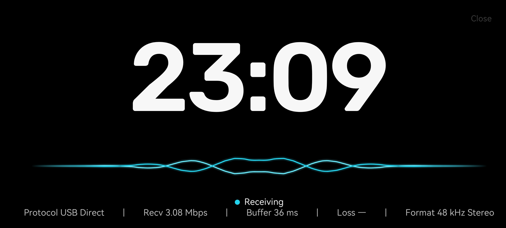

  

<h1 align="center">AnPod</h1>

把 Windows 电脑的声音发送到 Android 手机，支持 USB 和无线连接。目前处于 Preview 阶段。本地候选为 PC 1.14.1 + Receiver 0.21.0-v3-flow-candidate/code 46，实机连接、音质与长期播放待用户验证；公开下载以 Releases 为准。

PC 使用 Soft Minimal 布局：设备、连接路径、真实状态和主操作按使用顺序呈现，设置与帮助/诊断入口保持易达；设置按界面、音频、连接、关于与诊断分组，并区分请求音质档位和实际格式。

## 使用要求

- Windows 10/11 x64；需 Microsoft Edge WebView2 Runtime，便携包不包含该运行时。
- Android 6.0 或更高版本。
- 首次安装和配对需通过 USB 调试授权电脑；USB Direct 配件模式另需手机授权。
- 无线 UDP 需要电脑和手机网络可互访，并在手机安装本版附带的 Receiver APK。
- 默认使用 Receiver 手机应用接收；Legacy 兼容方式和无线调试 ADB 可在高级设置中选择。

## USB 快速开始

1. 首次使用先连接 USB 并授权调试，点设备区的“首次设置”安装手机应用和配对。
2. 之后选择 ADB 或 USB Direct；新配置默认 USB Direct，已有选择会保留。Direct 的配件模式操作见下文。
3. 手动连接并播放；在任一端停止后，不会自动重连。

## USB Direct AOA（实验性）

USB Direct 需要 Android 7.0（API 24）或更高；ADB/LAN 仍支持 Android 6.0。

USB Direct 使用独立的 AOA 认证会话，不是 USB/ADB 的别名。当前仅对已验证的 iQOO 11 提供 WinUSB 预切换；切换前需明确允许停止电脑上的全局 ADB server。选择 Direct 模式只是连接偏好，不代表手机已完成物理 USB 模式切换，也不会自动开始播放。

1. 首次使用先通过 USB/ADB 安装 Receiver 并完成配对，再在 USB 下选择持久化的 ADB 或 USB Direct 模式。打开 Direct 主按钮或手机卡片可进入配置页。
2. AnPod 自动刷新只读发现的设备；发现唯一设备时会预选。需要物理切换 USB 模式时，展开切换选项并按提示操作；切换仅支持已验证的 iQOO 11，且须明确允许停止电脑上的全局 ADB server。然后在手机 Receiver 中允许配件权限。
3. 选择已配对的接收端，或使用同一设备的已认证记忆，再明确点击“开始连接”才会播放。初次连接始终手动发起；意外断线仅在同一连接方式内有界恢复，不会自动切换 Direct、ADB 或 LAN；任一端手动停止后不会重连。

Receiver 46 的 USB／无线 ADB、Direct 与 LAN 均支持三档音质；Legacy 和旧版 Receiver 的 ADB 仍仅支持 Standard。Standard 为 48 kHz PCM16，HiFi 为 48 kHz Float32，Hi-Res 为 96 kHz Float32，均为双声道。HiFi／Hi-Res 要求 Windows 混音与采集格式匹配；Android 实际输出以诊断为准，设备可能重采样，Float32 不代表 DAC 位深。Oboe 为默认引擎，AudioTrack 为备用；已有手选设置保留。实机连接、播放与声学表现待验证，见 [AOA 传输记录](docs/audio-quality/06-aoa-transport.md)。

## 无线 UDP 快速开始

1. 首次使用先用 USB 连接手机，按 PC 端“首次设置”完成配对和手机应用安装。
2. PC 选择“无线”，点击“连接手机”。需要时选择电脑网络和已配对手机；若进入等待，在手机点“连接电脑”，再由 PC 确认请求。高保真／Hi-Res 使用相同流程。
3. 若要让手机在后台等待 PC，可在“其他设置”中开启“允许电脑连接”，并按手机提示授权。找不到手机时展开连接页的帮助。

监听和已保存授权不会自动开始播放；授权可在两端查看、取消。关闭“允许电脑连接”不等于撤销已保存的授权。

## 手机常显（AOD）

手机端提供“伪 AOD”常显：纯黑横屏、大号时钟和真实 PCM 双线波形。英文参数居中并用 `|` 分隔，默认显示状态、协议、接收码率、接收端缓冲和 UDP 缺帧率；可另选实际音频格式、输出引擎和欠载次数。USB Direct 只在真实 PCM 入流时显示接收统计；Oboe 与 AudioTrack 共用这一路统计，未知数据保留 `—`。无法进一步识别的有线或无线 ADB 设备统一显示“ADB”。

- 在 Receiver 主界面点击“进入常显”即可打开；自动进入仍由“屏幕常显”开关控制。
- “常显设置”可调整时钟字号、波形粗细和监控项，小预览即时响应。预览使用静态时间和未知数据，不新增采样；设置保存在手机本地。
- 双线波形分别对应立体声的两个声道，共用同一条基线、没有文字标记；右声道反相，所以即使左右声道音频完全一致，也会一条向上、一条向下。
- 指标口径：Recv 为音频 payload 码率，Buffer 为接收端可观测缓冲，Loss 为 UDP 缺帧率（USB/ADB 显示 `—`）。
- 数字静音仍保持显示，波形回到中心直线。已有会话连续中断约 15 秒才会退出；切换“均衡/低延迟”的短暂会话重建不会让常显退出重进。
- 退出后可从通知的“打开常显”重进；手机不在前台时受 Android 后台启动限制，不会自动弹出。
- 时钟、波形与底部指标栏作为一个整体缓慢漂移（横向约 ±16dp、纵向约 ±9dp），不会长期停在同一批像素上；停留约 6 秒无操作后右上角“Close”淡出，触摸任意位置恢复。
- AMOLED 纯黑、遵从系统亮度；长时间常亮仍有耗电与烧屏风险，锁屏/灭屏后不显示。
- 右侧上下滑动调整手机媒体音量，从第一段滑动就生效，操作时显示系统音量条；实体音量键继续可用。
- 连接、切换播放模式等操作在后台完成，不会弹出手机界面。

完整说明、指标口径与限制见 [`docs/AOD.md`](docs/AOD.md)。

## 升级

手机 APK 随 PC 便携包提供。USB 连接后从 PC 的“手机应用”入口检查并升级。1.5.0 起 Receiver 使用独立的发布密钥签名；从 1.4.0 及更早的 debug 预览包切过来需要先卸载一次（配对会一起清掉，需重新走 USB 配对），此后同签名的版本可原地升级。密钥与打包流程见 [`packaging/SIGNING.md`](packaging/SIGNING.md)。

每次出包都会递增 Receiver `versionCode`，并同步更新 PC 端的 `AUDITED_RECEIVER_ARTIFACTS`。不要用同 `versionCode` 的 APK 覆盖安装：部分手机（vivo 等）会要求确认“已安装相同版本”，且 PC 会按精确哈希判定为未核验。PC 与手机请使用同一套发布包。

## 版本与变更

手机 APK 随 PC 便携包提供，两端需配套使用。各版本改动与制品见 [GitHub Releases](https://github.com/sanren1/AnPod/releases) 和提交历史。

## 延迟测试记录

PC 1.2.1 + Receiver 0.9.1/code 12；每档约 24 秒、10 个提示音，10/10 匹配并经独立复核。

下表是 **1.2.1 的历史测量**。后续版本尚未重新测量，因此这些数字不能当作当前版本的延迟结论。

| 连接与档位 | 中位数 | P95 |
| --- | ---: | ---: |
| USB · 均衡 | 156.720 ms | 157.111 ms |
| USB · 低延迟 | 123.269 ms | 125.299 ms |
| 无线 UDP · 均衡 | 310.645 ms | 314.294 ms |
| 无线 UDP · 低延迟 | 187.394 ms | 200.240 ms |
| 电脑本机 · 基准 | 71.699 ms | 71.778 ms |

电脑本机基准是独立路径，仅作参照，不与四档结果相减。测量包含声学与麦克风链路，是端到端时差，并非纯传输延迟。无线 UDP 低延迟组有两次低匹配分，仅供参考；这不代表音乐音质通过。

这组历史测量的完整记录保存在本地测试资料中，不随公开源码分发。

## 已知问题

- 低延迟档长时播放可能出现短时卡顿，日常优先使用均衡档。
- 常显仍是预览功能：长时间烧屏与功耗、通知兜底、锁屏/灭屏不显示等仍待完整真机验收。
- 音乐音质与长期稳定性尚未验收；短时延迟测试不能替代实听。
- Receiver 使用正式发布签名，与更早的 debug 预览包不能互相覆盖安装；从旧包升级需先卸载一次。

## 下载与反馈

公开版本发布后可从 [GitHub Releases](https://github.com/sanren1/AnPod/releases) 下载。问题反馈请到 [GitHub Issues](https://github.com/sanren1/AnPod/issues)，附上连接方式、Windows/Android 版本和复现步骤；提交诊断前请检查设备名、网络地址等隐私信息。

## 开发

源码构建依赖 Rust stable、Node.js/npm、MSVC x64 C++ 工具；重建 Receiver 另需 JDK 17 与 Android SDK。前端使用 `cd frontend; npm ci; npm run build`。便携包入口见 [`packaging/publish-tauri.ps1`](packaging/publish-tauri.ps1)，构建前请阅读其中参数及脚本要求。旧 WPF 实现保留在 `src/AnPod.Desktop/`。

提交 Rust 改动前运行 `cargo fmt --manifest-path src-tauri/Cargo.toml --check`；发现排版差异先运行同命令去掉 `--check` 修正，再复查。其余检查以 [Windows CI 工作流](https://github.com/sanren1/AnPod/blob/dev/.github/workflows/windows-checks.yml) 为准。

第三方许可与上游声明见 [`THIRD_PARTY_NOTICES.md`](THIRD_PARTY_NOTICES.md)、[`LICENSES/`](LICENSES/) 和 [`upstream/`](upstream/)。项目自有代码以 **GPL-3.0-or-later** 发布，完整文本见 [`LICENSE`](LICENSE)；其中改编自 AudioShare 的部分仍按 LGPL-3.0-or-later 说明处理。
